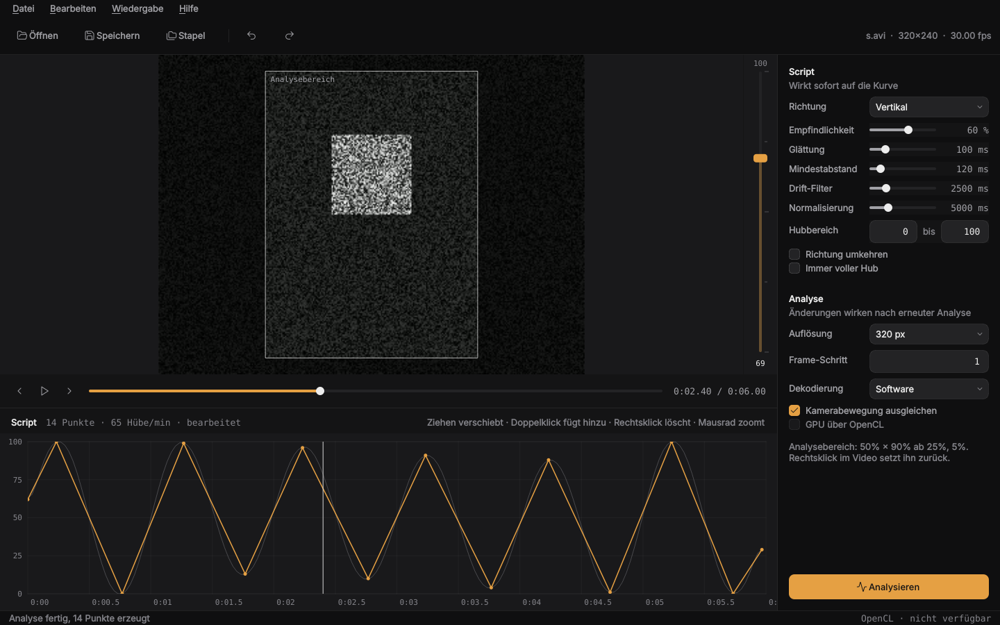

# Video-to-Funscript Generator

Kostenlose, quelloffene Software zur **lokalen** Videoanalyse und automatischen
Erstellung von Funscripts. Keine Cloud, keine Abos, keine API-Kosten.



Entwickelt und getestet für Nobara Linux (KDE) mit AMD Ryzen 7 3700X und
Radeon RX 5700 XT – läuft aber auf jedem Linux mit Python ≥ 3.10.

## Funktionen (Stand 0.1)

| | Funktion | Status |
|---|---|---|
| 1 | Grafische Oberfläche (PySide6) | ✅ |
| 2 | Videovorschau mit Abspielen, Frame-Schritt, Suchleiste | ✅ |
| 3 | Automatische Bewegungsanalyse (dichter optischer Fluss) | ✅ |
| 4 | Bewegungsrichtung (vertikal / horizontal / automatisch) und Bewegungsumfang | ✅ |
| 5 | Einstellbare Empfindlichkeit, Glättung, Mindestabstand, Drift-Filter | ✅ (Live-Vorschau) |
| 6 | Analysekurve anzeigen und Punkte bearbeiten (inkl. Rückgängig) | ✅ |
| 7 | Funscript-Export (`<Video>.funscript` neben dem Video) | ✅ |
| 8 | Stapelverarbeitung ganzer Ordner (GUI + Kommandozeile) | ✅ |
| 9 | Bereits analysierte Videos überspringen | ✅ |
| 10 | Bluetooth-Anbindung Fredorch F21S | geplant (z. B. über [Intiface/Buttplug](https://intiface.com/), Open Source) |

## Installation als AppImage (am einfachsten)

Eine Datei, keine Installation, Python wird nicht benötigt:

1. Unter **Releases** (oder unter Actions → appimage → Artifacts) die Datei
   `Video-to-Funscript-<Version>-x86_64.AppImage` herunterladen.
2. Ausführbar machen und starten:
   ```bash
   chmod +x Video-to-Funscript-*.AppImage
   ./Video-to-Funscript-*.AppImage
   ```
   Oder in Dolphin: Rechtsklick → Eigenschaften → Berechtigungen → „Ausführbar“.
3. Optional ins Startmenü aufnehmen: mit **Gear Lever** (Flatpak, in Discover)
   die AppImage-Datei öffnen und „Unlock / Move to the app menu“ wählen.

FFmpeg und die OpenCL-Treiber kommen weiterhin vom System (siehe unten).
Ohne FFmpeg dekodiert das AppImage über das mitgelieferte OpenCV.

## Installation aus dem Quellcode (Nobara / Fedora)

```bash
sudo dnf install git python3 ffmpeg          # ffmpeg ist bei Nobara meist schon da
git clone https://github.com/conty1337/Video-to-funscript-Generator.git
cd Video-to-funscript-Generator
./install.sh
```

`install.sh` legt eine virtuelle Umgebung `.venv` an, installiert NumPy, OpenCV
und PySide6, erstellt einen **Startmenü-Eintrag** und die Befehle `vtf-gui` und
`vtf` in `~/.local/bin`.

Starten: Startmenü → „Video-to-Funscript Generator“, oder `./start.sh`.

### GPU (RX 5700 XT)

Die Software nutzt die Grafikkarte auf zwei Wegen, beides optional:

* **Hardware-Dekodierung (VAAPI)** über FFmpeg – funktioniert mit dem
  Mesa-Treiber von Nobara direkt. Einstellung „Hardware-Dekodierung“.
* **OpenCL** für den optischen Fluss (OpenCV T-API). Dafür eine
  OpenCL-Laufzeit installieren, z. B.
  `sudo dnf install mesa-libOpenCL` (Mesa rusticl, wird von `start.sh` mit
  `RUSTICL_ENABLE=radeonsi` aktiviert) oder `rocm-opencl`. Danach in der GUI
  „GPU (OpenCL)“ anhaken. `vtf info` zeigt, ob ein Gerät gefunden wurde.

Hinweis: Bei der Standard-Analyseauflösung (320 px) ist die CPU (8 Kerne) oft
genauso schnell wie OpenCL, weil das Kopieren zur GPU Zeit kostet. Bei höheren
Auflösungen lohnt sich OpenCL eher.

## Bedienung

1. Video öffnen (Strg+O oder per Drag & Drop).
2. Optional: im Vorschaubild ein Rechteck um den relevanten Bereich ziehen
   (ROI). Rechtsklick entfernt die ROI. Das verbessert die Erkennung deutlich.
3. **Analysieren** klicken. Die Rohdaten werden zwischengespeichert
   (`~/.cache/video-to-funscript`), eine erneute Analyse desselben Videos mit
   denselben Einstellungen ist sofort fertig.
4. Script-Einstellungen anpassen – die Kurve aktualisiert sich sofort:
   * **Empfindlichkeit**: höher = auch kleine Bewegungen werden zu Punkten.
   * **Glättung**: entfernt Zittern.
   * **Mindestabstand**: kleinster zeitlicher Abstand zwischen zwei Punkten.
   * **Drift-Filter**: entfernt langsames Wegdriften der Position.
   * **Normalisierung**: Fenster, in dem der Hub auf den vollen Bereich
     skaliert wird (0 = über das ganze Video).
   * **Bewegungsumfang**: minimale/maximale Position (0–100).
   * **Umkehren** / **Immer voller Hub**.
5. Punkte bearbeiten: ziehen = verschieben, Doppelklick = neuer Punkt,
   Rechtsklick oder Entf = löschen, Mausrad = Zoom, Umschalt+Mausrad = scrollen,
   Klick in die Kurve = zu dieser Stelle springen. Strg+Z / Strg+Umschalt+Z.
6. **Strg+S** speichert `<Video>.funscript` neben dem Video – so finden es
   Player automatisch.

**Stapelverarbeitung**: Datei → Stapelverarbeitung (Strg+B) oder einen Ordner
ins Fenster ziehen. Es werden die aktuellen Einstellungen verwendet. Videos, für
die schon ein `.funscript` existiert, werden übersprungen (abschaltbar).

## Kommandozeile

```bash
vtf analyze video.mp4                      # erzeugt video.funscript
vtf analyze video.mp4 --sensitivity 70 --roi 0.2 0.1 0.6 0.8
vtf batch ~/Videos                         # ganzer Ordner, bereits analysierte überspringen
vtf batch ~/Videos --overwrite --opencl
vtf info                                   # FFmpeg/OpenCL prüfen
vtf analyze --help                         # alle Optionen
```

## AppImage selbst bauen

```bash
sudo dnf install squashfs-tools   # mksquashfs, meist schon installiert
./scripts/build-appimage.sh       # erzeugt dist/Video-to-Funscript-<Version>-x86_64.AppImage
```

Der Build braucht keine Downloads außer den Python-Paketen: Die AppImage-Runtime
liegt in `packaging/` (siehe [packaging/RUNTIME.md](packaging/RUNTIME.md)).

Die GitHub-Action `appimage` baut das AppImage bei jedem Push auf `main` und bei
jedem PR automatisch und testet es (Video analysieren, Screenshot). Bei einem
Tag `v*` wird es an das Release angehängt.

## Wie die Analyse funktioniert

1. FFmpeg dekodiert das Video verkleinert in Graustufen (optional per VAAPI).
2. Für jedes Bildpaar berechnet OpenCV den dichten optischen Fluss
   (Farnebäck). Die globale Kamerabewegung (Median) wird abgezogen und aus den
   am stärksten bewegten Pixeln ein Bewegungsvektor gebildet.
3. Die Geschwindigkeit wird auf die gewählte Achse projiziert und zu einer
   Position aufsummiert, Drift wird entfernt, geglättet und normalisiert.
4. Hoch- und Tiefpunkte (mit Hysterese = Empfindlichkeit) werden zu
   Funscript-Punkten.

Da Schritt 1–2 (teuer) von 3–4 (billig) getrennt sind, wirken
Script-Einstellungen sofort ohne neue Analyse.

## Gestaltung

Die Oberfläche folgt einer festen Gestaltungsrichtung (Schnittplatz bei Nacht,
ein Bernstein-Akzent nur für das Script). Details und Quellen stehen in
[docs/design.md](docs/design.md).

## Entwicklung

```bash
.venv/bin/pytest
```

Projektstruktur:

```
src/vtf/
  video.py       Video-Infos + schnelles Dekodieren (FFmpeg/OpenCV)
  analysis.py    Optischer Fluss -> Bewegungsdaten (+ Cache)
  generator.py   Bewegungsdaten -> Kurve -> Funscript-Punkte
  funscript.py   Dateiformat
  batch.py       Ordnerverarbeitung
  gpu.py         OpenCL-Hilfen
  cli.py         Kommandozeile (vtf)
  gui/           PySide6-Oberfläche (vtf-gui), Gestaltung in gui/theme.py
```

## Lizenz

MIT – siehe [LICENSE](LICENSE).
