# Video-to-Funscript Generator

**English** · [Deutsch](README.de.md)

Free, open-source software that analyses videos **on your own computer** and turns
the motion into funscripts. No cloud, no subscription, no API costs.

**→ [Guide: from video to script in 8 steps](docs/guide.md)**

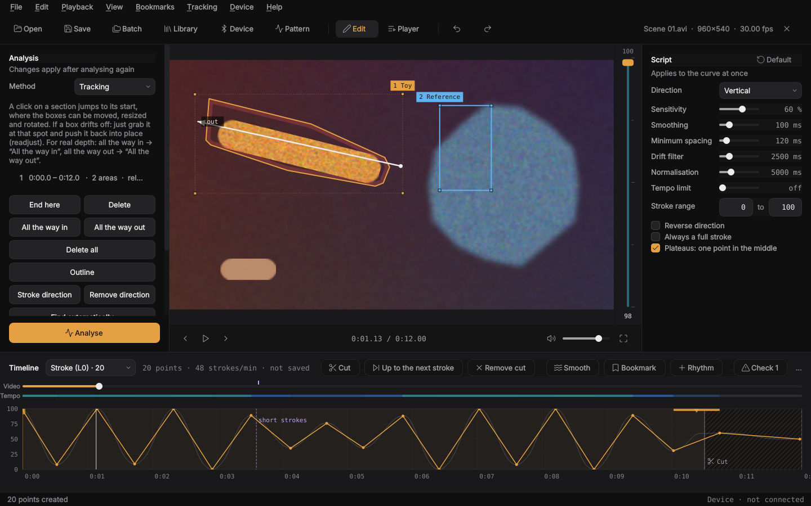

| Tracking | Player | Pattern control |
|---|---|---|
| [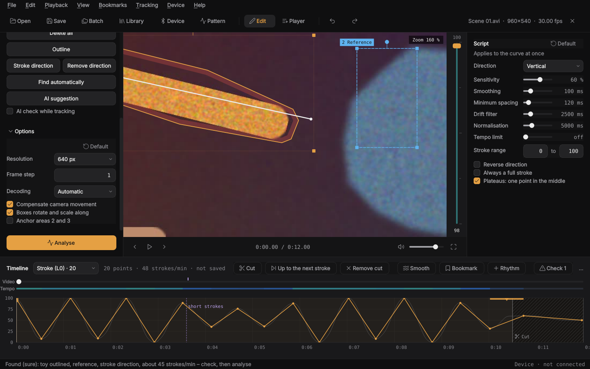](docs/images/en/tracking.png) | [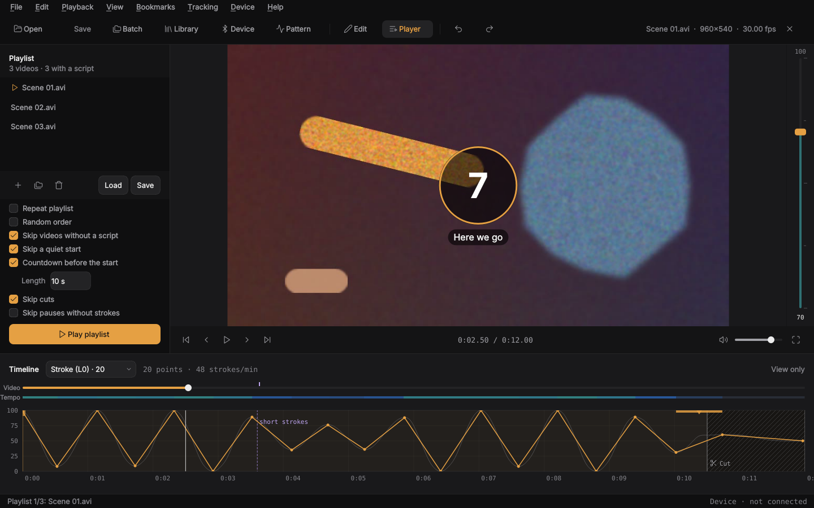](docs/images/en/player.png) | [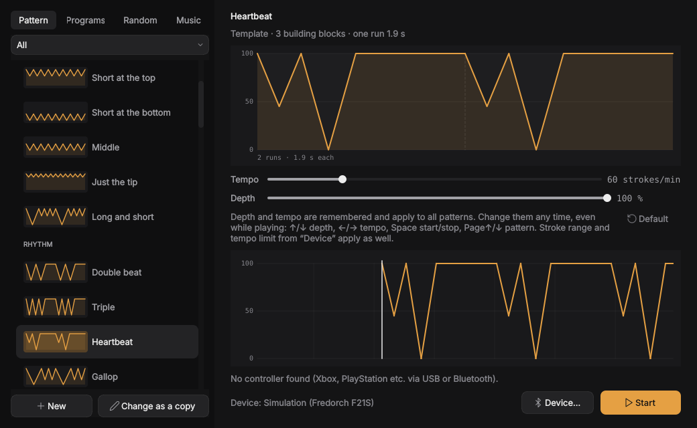](docs/images/en/patterns.png) |
| Found automatically: toy outlined, reference, stroke direction | Playlist, countdown, cuts are skipped | Patterns, programs, random and music without a video |
| **Library** | **Phone remote** | **Accent colour** |
| [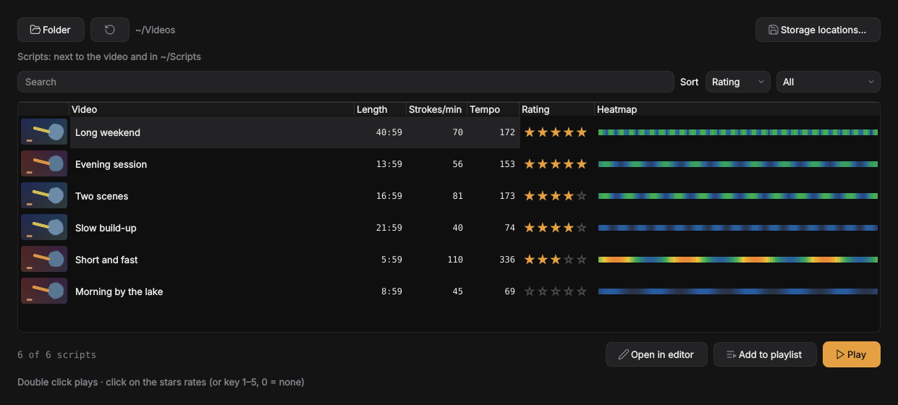](docs/images/en/library.png) | [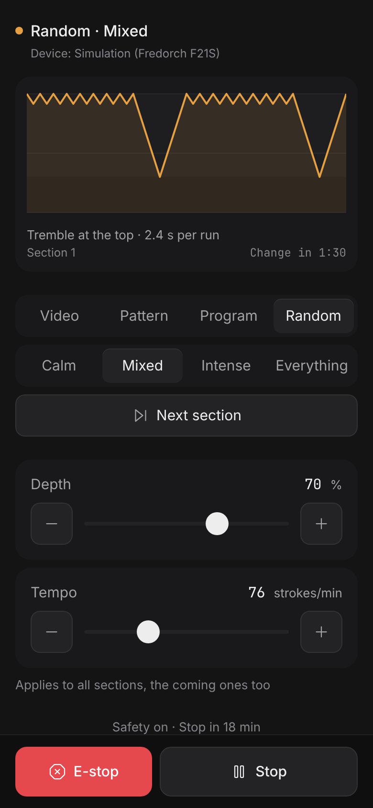](docs/images/en/remote.png) | [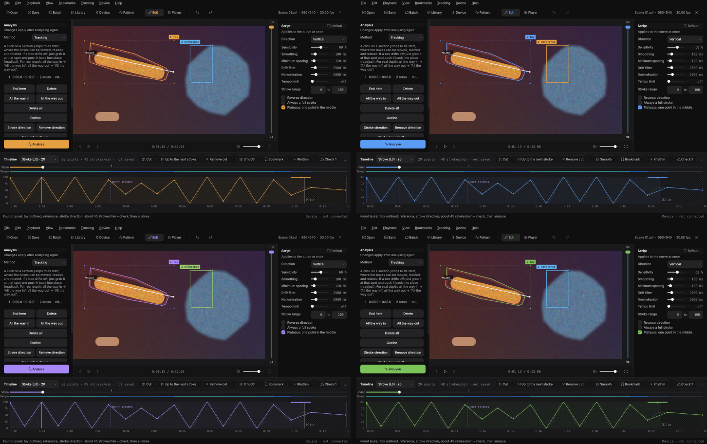](docs/images/en/accents.png) |
| Every script in a folder, with heatmap and stars | Start, stop, depth, tempo and the player from your phone | Six colours or one of your own |

Built and tested on Nobara Linux (KDE) with an AMD Ryzen 7 3700X and a Radeon
RX 5700 XT, but it runs on any Linux with Python ≥ 3.10. The interface is in
**English and German**.

## What it does

**Create scripts**
- Motion analysis by dense optical flow, or **tracking** of the parts you mark
  (up to 3 areas: the toy and a reference, so camera moves do not matter)
- **Find automatically** (F): the app spots what moves in a rhythm, outlines the
  toy, picks a reference and draws the stroke direction
- **Outline** instead of a rectangle, **stroke direction** as an arrow, rotating
  boxes, readjusting, occlusion and image edges bridged
- Optional **AI body detection**: boxes suggested on body parts, and an AI check
  that keeps each box on its body part (runs locally)
- **Depth calibration** (all the way in / out) for real stroke depth
- More axes for multi-axis devices: surge, sway, twist, roll, pitch
- Batch processing of whole folders (GUI and command line)

**Edit**
- Scripts next to the video and/or in a **script folder**, video data in a folder of its own
- Curve editor with multi-select, copy/paste, smooth, stronger/weaker strokes, undo
- **Script check**: too fast, gaps, tremble, sudden small strokes, beat drops out,
  lost areas; F3 jumps to the next spot
- **Cuts** (X) for stretches where nothing happens, bookmarks, rhythm templates,
  script from music, heatmap and tempo limit

**Play**
- Player mode with playlist, sound, countdown before the start, quiet starts,
  cuts and long pauses skipped
- **Library** (Ctrl+L) with heatmap, search, sorting and ratings, local **statistics**
- **Pattern control** without a video: over 50 patterns, your own made of building
  blocks, programs (e.g. one hour), random, music mode, game controller
- Other players: mpv, VLC, DeoVR, HereSphere

**Devices**
- Fredorch F21S and hundreds more via [Intiface Central](https://intiface.com/central/),
  OSR2/SR6 and other TCode devices with all axes, vibrators; a simulation without a device
- Setup assistant, **phone remote** in the browser (QR code), safety timer, emergency stop (Esc)

## Install as an AppImage (easiest)

One file, nothing to install, no Python needed:

1. Download the latest version:
   [Video-to-Funscript-x86_64.AppImage](https://github.com/conty1337/Video-to-funscript-Generator/releases/latest/download/Video-to-Funscript-x86_64.AppImage)
   (or under **Releases**).
2. Make it executable and start it:
   ```bash
   chmod +x Video-to-Funscript-*.AppImage
   ./Video-to-Funscript-*.AppImage
   ```
   Or in Dolphin: right click → Properties → Permissions → “Is executable”.
3. On its first start the app adds itself to the start menu (can be switched off
   under Help → “Show in the start menu”). Best put the file in its permanent
   place first, e.g. `~/Applications`. If you move it, the next start updates
   the entry. **Gear Lever** users get no duplicate entry.

**Updates come by themselves:** on start the app looks for a new version,
downloads it in the background, checks it by SHA-256 and replaces the AppImage
file. The next start, or “Restart” in the status bar, uses the new version.
Manually: Help → “Check for updates”; switch off under Help → “Update
automatically”. The folder with the AppImage must be writable (e.g.
`~/Applications`, as with Gear Lever).

FFmpeg and the OpenCL drivers still come from the system (see below). Without
FFmpeg the AppImage decodes with its bundled OpenCV.

## Install from source (Nobara / Fedora)

```bash
sudo dnf install git python3 ffmpeg          # ffmpeg is usually there on Nobara
git clone https://github.com/conty1337/Video-to-funscript-Generator.git
cd Video-to-funscript-Generator
./install.sh
```

`install.sh` creates a virtual environment `.venv`, installs NumPy, OpenCV and
PySide6, adds a **start menu entry** and the commands `vtf-gui` and `vtf` in
`~/.local/bin`.

Start: start menu → “Video-to-Funscript Generator”, or `./start.sh`.

### GPU (RX 5700 XT)

The software can use the graphics card in two ways, both optional:

* **Hardware decoding (VAAPI)** via FFmpeg: works with Nobara's Mesa driver
  right away. Setting “Decoding”.
* **OpenCL** for the optical flow (OpenCV T-API). Install an OpenCL runtime,
  e.g. `sudo dnf install mesa-libOpenCL` (Mesa rusticl, enabled by `start.sh`
  with `RUSTICL_ENABLE=radeonsi`) or `rocm-opencl`. Then tick “GPU via OpenCL”
  in the options. `vtf info` shows whether a device was found.

At the default analysis size the CPU (8 cores) is often as fast as OpenCL,
because copying to the GPU costs time. At higher resolutions OpenCL pays off more.

## Using the app

A short step-by-step guide is in [docs/guide.md](docs/guide.md). Here is
everything in detail.

**Layout**: analysis on the left (method, tracking, options, “Analyse”), the
video in the middle with the stroke rail, script settings on the right, and the
timeline at the bottom with the tracks video, tempo and curve. Ctrl+1 / Ctrl+2
fold the left / right panel away, Ctrl+W closes the video.

1. Open a video (Ctrl+O or drag and drop).
2. Optional: draw a rectangle around the relevant part of the picture (ROI).
   A right click removes it. This helps the detection a lot.
3. Click **Analyse**. The raw data is cached (`~/.cache/video-to-funscript`);
   analysing the same video with the same settings again is instant.
4. Adjust the script settings; the curve follows at once:
   * **Sensitivity**: higher = small movements become points too.
   * **Smoothing**: removes tremble.
   * **Minimum spacing**: shortest time between two points.
   * **Drift filter**: removes slow drifting of the position.
   * **Normalisation**: window in which the stroke is stretched to the full
     range (0 = the whole video).
   * **Stroke range**: lowest/highest position (0–100).
   * **Reverse direction** / **Always a full stroke**.
   * **Plateaus: one point in the middle** (on): if it rests briefly all the way
     in or out, or trembles there, one point goes in the middle instead of two
     at the edges. Switch off where there are real small double thrusts.
5. Edit points: drag = move, double click = new point, right click or Del =
   delete, mouse wheel = zoom, click in the curve = jump there. Ctrl+Z /
   Ctrl+Shift+Z. **Several points**: Shift or Ctrl+drag on empty space draws a
   selection rectangle, Ctrl+click toggles single points, Ctrl+A selects all.
   Selected points move together. Ctrl+X/C/V cut, copy and paste at the playback
   position (into another video too), Ctrl+G smooths the selection, Ctrl+↑/↓
   makes the strokes stronger or weaker. Move the curve: drag empty space (or
   the middle mouse button), the scroll bar below, Shift+mouse wheel or a
   sideways swipe on the touchpad. Video timeline: a click jumps right there
   and can be dragged on, the mouse wheel steps 1 s.
6. **Ctrl+S** saves `<video>.funscript` next to the video, where players find it,
   or into your **script folder** (see below).

**Sound** plays along, in sync with the picture and the device. The speaker
button or **M** mutes it, the slider sets the volume. Both are remembered.

### Tracking

More precise for busy videos. Choose “Method: Tracking”, go to a spot where
everything is easy to see and draw up to 3 areas in the video, e.g. around the
two body parts. Each area is followed by many image points.

* 1 area: its own movement (camera movement is subtracted).
* 2–3 areas: area 1 (the toy, what moves) relative to the others (the
  reference, e.g. the body). The camera no longer matters, zoom and pans
  hardly disturb. A right click on a box changes its role.
* **Find automatically** (F or the button): the app looks at a few seconds from
  the playback position. What moves far, evenly in a rhythm and together becomes
  the toy (outlined right away), a textured spot next to it that moves little
  becomes the reference, plus the stroke direction (tip away from the reference
  = out). Then check briefly and adjust if needed. Works best at a spot with
  even strokes and a calm camera.
* **Outline** (U): trace closely around the toy instead of drawing a rectangle.
  Only points inside, a few pixels away from the edge, are followed, so a finger
  or foot right next to it no longer pulls the box away.
* **Stroke direction** (H): an arrow along the thrust, tip = out. The script
  measures only along the arrow, sideways wobbling does not count.

[](docs/images/en/tracking.png)

*Sections*: marking starts a section at that spot. **End here** (E) ends it,
e.g. when the scene is over. After a scene change simply mark again at the new
spot, and a new section starts there. Points are only created inside sections.
The sections are listed in the settings (a click jumps to the start) and shown
as light bands in the curve. A right click in the video opens a menu: on a box
(or just next to it) for that box (role, outline, remove), elsewhere for the
section (delete, remove stroke direction). Nothing is deleted by a right click
directly, and **Ctrl+Z** undoes tracking changes too.

*Depth calibration*: go to a spot where it is all the way in and click **All
the way in** (D), then to a spot all the way out and click **All the way out**
(A). From then on the script in this section uses the real distance of the
areas: all the way in = 0, all the way out = 100, short strokes stay short.
Without calibration every stroke is stretched to the full range. Calibration
applies at once, without a new analysis.

While playing, the preview shows where the areas are.

*Adjusting boxes*: at the start of a section (click in the list) drag inside =
move, a corner = size, the round handle or the mouse wheel = rotate (Shift =
finer steps). Small spots: **Ctrl+mouse wheel** zooms into the video, the middle
mouse button moves the view, Ctrl+0 resets. For very small boxes the status bar
suggests a higher analysis resolution (default 640 px).

*Options* (left, folded): resolution, frame step, decoding, compensate camera
movement, **Boxes rotate and scale along** (off for machines and rigid parts:
the boxes then only move) and **Anchor areas 2 and 3** (they stay where they
were marked and only move with the camera, nothing can pull them away; off
with camera moves).

*Drifting boxes and occlusion*: the tracker checks for impossible jumps and
compares every few frames with the look at marking time (and at each
correction), turned and scaled too. If something moves in front, even partly
like a hand, the area jumps back to its last safe spot, turns red and waits
until it can be seen again. Red stretches in the curve: an area was covered or
lost there, no strokes are created. If something goes over the **image edge**,
the box follows the visible rest until less than 40 % of it is in the picture.
Then it waits at the edge and is found again when it comes back. The stretch
outside (up to 2.5 s) is continued from the movement when leaving and when
coming back, so even a turning point outside the picture lands in the script.
Short occlusions (up to 1 s, e.g. a hand wiping across) are bridged the same
way, including the frames just before, in which the box was already dragged
along. If a box still sits wrong: **grab it at that spot and push it into
place** (*readjust*). After the next analysis the area follows from there, and
the stretch before is tracked backwards and evened out. The start and end of a
section can be dragged in the curve.

### AI body detection

Optional, local, no internet after the first download. Step by step with
pictures in the [guide](docs/guide.md#boxes-with-the-ai).

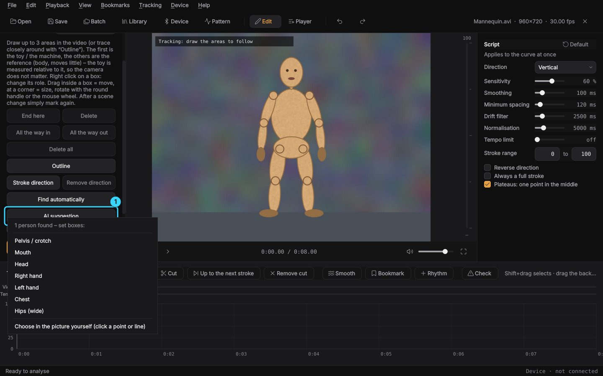

- **AI suggestion** (K): finds the people in the current picture and offers
  boxes for pelvis/crotch, hips, mouth, head, chest and both hands. A click sets
  the box, then adjust as usual. At the same time the AI shows its **skeleton**
  in the video (joints, lines, hands with fingers). A click on a point sets a
  box there, a click on a line (e.g. a thigh) a turned box along the line.
- **AI check while tracking** (tick under the button): during the analysis,
  body detection checks about every second, when unsure every third frame,
  whether each box still sits on the body part it was put on. If it slips away,
  it is brought back. If a hand lies on it for longer, the box waits where the
  AI sees the body part, and the stretch is bridged through these spots (single
  outliers of the AI are dropped). It costs time: a check with a person search
  takes about 0.5 s on the CPU, the frequent glances in between look for the
  person where they just were and take about a third of that. In a hard case
  (a hand on the pelvis for 10 s) the error stays under 10 px instead of 200 px,
  and almost all strokes make it into the script.
- **Models**: YOLOX-m (finds people) and RTMW-l (133 body points with hands, feet
  and face) by OpenMMLab, licence Apache-2.0, about 330 MB together. They are
  downloaded on first use after asking, first from the copy in the release
  [ki-modelle](https://github.com/conty1337/Video-to-funscript-Generator/releases/tag/ki-modelle)
  here on GitHub (fast), otherwise directly from OpenMMLab. An interrupted
  download resumes next time, the checksums are verified, and they end up in
  `~/.local/share/video-to-funscript/models`. If an app update brings newer
  models, the app asks again and deletes the old ones afterwards. They run on
  the OpenCV already inside the app, so the AppImage does not get bigger.
- Good with whole bodies and medium shots. In very close shots with hardly any
  body points visible the AI finds nothing; then there is no suggestion and the
  check stays off for that box.

*Preparation*: areas, sections and calibration are saved at once as
`<video>.vtf.json` next to the video (or in the folder for video data, see
*Storage locations*) and loaded the next time it opens.
Ctrl+Page↓ / Ctrl+Page↑ opens the next/previous video in the folder, so many
videos can be prepared quickly. Batch processing uses the preparation; videos
without one run with “Image motion”.

### More axes

Above the curve you choose the axis: stroke (L0), surge (L1), sway (L2), twist
(R0), roll (R1) or pitch (R2). Each axis has its own points and is saved as
`<video>.roll.funscript` etc. next to the video, as multi-axis players
(MultiFunPlayer, OFS) expect. Edit → “Create more axes from the analysis”
computes sway from the sideways movement and roll from the angle between
tracking areas 1 and 2. Twist and pitch you set by hand. The Fredorch F21S has
one axis only, so the device always follows “Stroke”.

### Check, cuts, bookmarks

**Check**: after every change the app checks the script and marks spots worth a
second look at the top of the curve: too fast for the device (tempo limit or
500 pos./s), gaps from 4 s, tremble (many tiny movements), strokes suddenly much
smaller than around them (box slipped?), one stroke much slower than the others
(beat drops out) and spots where tracking lost an area. The “Check” button in
the timeline shows the list, **F3** / **Shift+F3** jump to the next/previous
spot (one second before). Cuts are not checked.

**Cuts**: where nothing happens, press **X** at the start and **X** again at the
end (or **Shift+X**: cut from here to the countdown before the next stroke).
Cuts are hatched in the curve, saved in `<video>.vtf.json`, and the player skips
them (“Skip cuts”). Edit → “Remove the cut here” takes one out. Optionally the
player also skips every pause without strokes from 15 s (“Skip pauses without
strokes”; after the last stroke the next video comes). As at the start, the
countdown runs before it goes on, after every skipped cut and every pause from 10 s.

**Bookmarks and rhythm**: B sets a named bookmark, Alt+→/← jump to the
next/previous one, the “Bookmarks” menu lists them all. They show in curve and
timeline and are saved in `<video>.vtf.json`. Ctrl+T (“Insert rhythm”) fills a
range with a beat: even, getting faster or slower, double beat or waves, with
tempo and depth, or with any pattern from the pattern control.

**Heatmap and tempo limit**: the tempo track in the timeline and the colour of
the stroke rail next to the video show the script's tempo (dark = slow, green,
yellow, red = fast). With **Tempo limit** (script settings) strokes that are too
fast are shortened right when created. For the F21S about 500 /s fits (a full
stroke in about 200 ms).

**Batch processing**: File → Batch processing (Ctrl+B) or drop a folder onto the
window. The current settings are used. Videos that already have a `.funscript`
are skipped (can be switched off).

### Player

Click **Player** at the top (Ctrl+P). The side panel then shows the playlist:
add videos or folders with + or drag them in, drag to reorder, Del removes.
The funscript next to each video plays on the connected device, one after the
other. Options: repeat, random order, skip videos without a script. Page ↑/↓
jumps to the previous/next video, F11 is full screen (Esc ends it, together with
the emergency stop). Playlists can be loaded and saved as `.m3u`, the app
remembers the last one. A quiet start is skipped (start shortly before the first
stroke), and a countdown runs before the start. Both can be switched off, the
**countdown length** is adjustable (3–30 s, default 10 s).

### Library and statistics

**Library** (Ctrl+L or the button at the top): every video with a script in a
folder (with subfolders), with length, strokes per minute, average tempo,
rating and heatmap. Search, sort (name, rating, tempo, newest, length) and
filter by stars. Rate: click the stars or press 1–5 (0 = none). A double click
plays, “Add to playlist” appends the selected ones, “Open in editor” to edit.
The ratings stay on your computer (`~/.config/video-to-funscript/library.json`).


**Storage locations** (File → “Storage locations…”, also in the library): by
default every file lies next to its video. Two folders change that:

- **Script folder**: one folder for all your scripts. Ctrl+S then saves into it
  and, if “Also save next to the video” is ticked (the default), next to the video
  too, where most players look. Library, player mode, batch processing and other
  players look next to the video first, then in the script folder and its
  subfolders (by file name, e.g. `Clip.funscript` for `Clip.mp4`).
- **Folder for video data**: the tracking boxes, sections, calibration, cuts and
  bookmarks (`<video>.vtf.json`) go there instead of next to the video, so the
  video folder stays tidy. Files already lying next to a video are still found and
  move into the folder the next time they are saved.

- **Preview pictures** (on by default): one small picture per video, shown in the
  library, the playlist, on the phone and when the app asks you to look for a
  missing video. Kept in the folder for video data (`thumbs/`) or else in
  `~/.local/share/video-to-funscript/thumbs`, never next to the video. Untick
  “Keep preview pictures” to delete them all.

When you change or clear a folder, the app offers to take the files along (into
the new folder, or back next to their videos). Two videos with the same name in
different folders share one file name in these folders. Stored in
`~/.config/video-to-funscript/scripts.json`.

**Opening a script opens its video**: open a `.funscript` (File → Open, drag and
drop, or a double click in the file manager) and the matching video opens with it,
in the player when you are in player mode. The app finds the video next to the
script, where it last saw it (also in subfolders there), or by name in the library
folder. If the video was moved or renamed, it asks you to look for it once and
remembers the new place. Scripts in the script folder whose video cannot be found
show up in the library as “video missing”; a double click looks for it.

**Statistics** (Device → Statistics…): playing time, strokes and days for today,
7 days, 30 days and in total, plus favourite videos and patterns (by playing
time). Counted is what plays with a script, and patterns/programs/random/music
from the pattern control. Everything stays on your computer
(`~/.config/video-to-funscript/stats.json`), “Reset” deletes it.

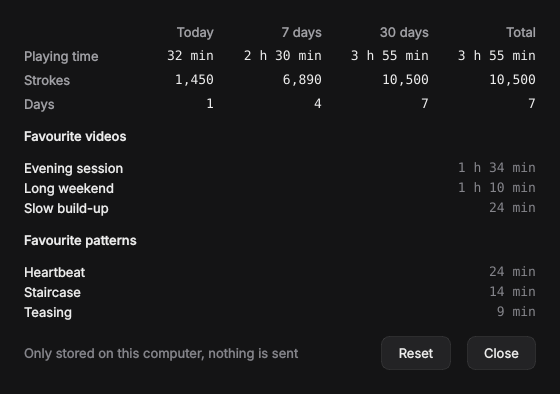

### Language and accent colour

View → **Language**: English or German, by default the language of the system.
The language changes after a restart; as an AppImage the app offers to restart
right away. Everything is translated, including the patterns and the phone
remote.

View → **Accent colour**: amber, blue, teal, green, violet, pink, or any colour
via “Custom colour…”, with a live preview while choosing. The accent marks the
script curve, the main button, progress, the stroke rail and tracking area 1,
on the phone remote too. If the colour is dark, the text on it turns white.
Both are stored in `~/.config/video-to-funscript/ui.json`.


## Controlling a device

The app plays the script on a device in sync with the video. The Bluetooth
connection is handled by **[Intiface Central](https://intiface.com/central/)**
(free, open source, an AppImage for Linux). It supports the **Fredorch F21S**
via its “fredorch” protocol; the device shows up as `YXlinksSPP`.

1. Start Intiface Central and click **“Start Server”** (address
   `ws://127.0.0.1:12345`).
2. Switch the device on. The maker's phone app must not be connected, the device
   allows one connection only.
3. In this app: **Device** (toolbar or Ctrl+D) → type “Intiface Central” →
   **Connect**. The app starts the device search, and the device appears in the list.
4. Test with **Top/Bottom**, then play the video: the device follows the script.

**Easiest the first time:** Device → **Setup assistant**. It walks through
connecting, direction, stroke range, top speed (4 strokes to try per step) and
delay. For the delay a circle lights up in a beat and clicks; the device should
be at the bottom exactly then. Move the slider until it fits.

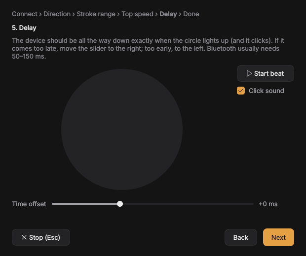 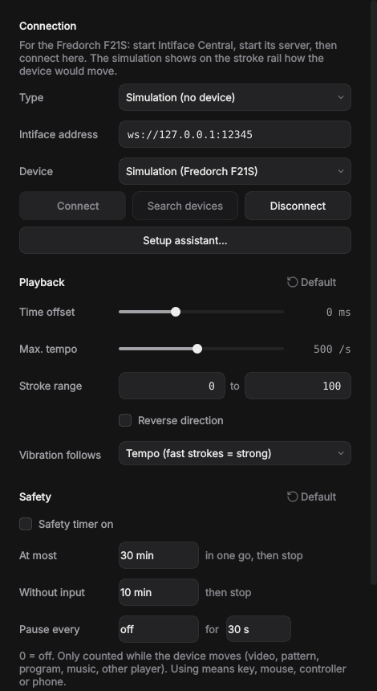

Without a device: type **“Simulation”**. The stroke rail next to the video shows
with a white outline where the device would be. The simulation behaves like
the F21S: 16 positions, a full stroke in about 200 ms at the earliest.

Settings in the device window:

- **Time offset**: makes up for the Bluetooth delay. Positive means the device
  gets its commands earlier. Starts at 0, typically 50–150 ms.
- **Max. tempo**: strokes that would be faster are shortened, not delayed. So the
  device stays in sync and is spared.
- **Stroke range**: which part of the device's travel is used (depth).
- **Reverse direction**.

**Safety:** on pause, seeking, closing and with **Esc (emergency stop)** the
device stops at once. After a start or a seek it first moves slowly to the
current script position and only then follows.

**Safety timer** (in the “Device” window, off by default): stops after a
maximum time in one go, stops if nothing was used for that long (key, mouse,
controller, phone), and if you like pauses briefly every few minutes, then goes
on by itself. Each value can be switched off on its own (0 = off). Only counted
while the device moves.

### Other devices

- **Vibrators and other devices without a stroke** via Intiface (Lovense, We-Vibe
  and hundreds more): the strength comes from the script. Under “Vibration
  follows” you choose whether fast strokes are strong (**Tempo**) or deep spots
  (**Depth**).
- **OSR2, SR6 and other TCode devices**: type “OSR2/SR6 etc. (TCode)”, as the
  address the USB port (`/dev/ttyUSB0` or `/dev/ttyACM0`) or `udp://IP:port`
  for Wi-Fi. All axes are used: stroke, surge, sway, twist, roll and pitch, also
  the ones the app creates itself. If the USB port does not open:
  `sudo usermod -aG dialout $USER`, then log in again.

### Other players

Device → **Other players (mpv, VLC, VR)**: the device follows the script while
you watch the video in another player. The script is looked for next to the
video (same name, `.funscript`) or in a script folder, subfolders included.

| Player | How to switch it on |
|---|---|
| mpv (most precise) | `mpv --input-ipc-server=/tmp/mpvsocket video.mp4` or `input-ipc-server=/tmp/mpvsocket` in `~/.config/mpv/mpv.conf` |
| VLC | Preferences → All → Interface → Main interfaces → “Web”, set a password under Lua, restart VLC |
| DeoVR | Settings → Remote control on, address = IP of the headset |
| HereSphere | Settings → DeoVR Remote on, address = IP of the headset |

### Phone remote

Device → **Phone remote** → “Remote on”. On your phone (same Wi-Fi) open the
address shown in the browser, for example `http://192.168.0.20:8765`, and enter
the PIN, or simply scan the **QR code** in the window with the phone camera;
then the PIN is already filled in. No app needed. The phone can start/stop,
**emergency stop**, choose pattern/program/random, set depth and tempo and jump
steps. In the **Video** tab it is the remote for the player: play/pause, ±10 s,
previous/next video, jump anywhere with the slider, see the time left and tap a
video in the playlist, plus the script curve around the current spot. The PIN
can be renewed any time, wrong PINs lock the phone out briefly. If the
connection does not work, the firewall blocks the port:
`sudo firewall-cmd --add-port=8765/tcp --permanent && sudo firewall-cmd --reload`.

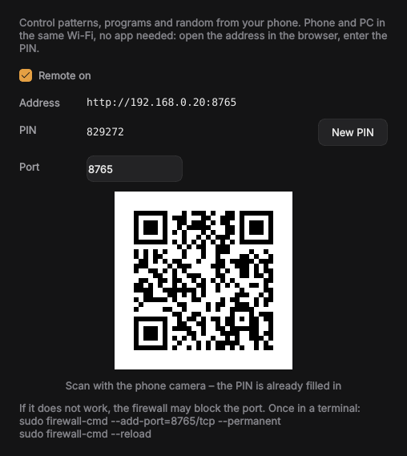  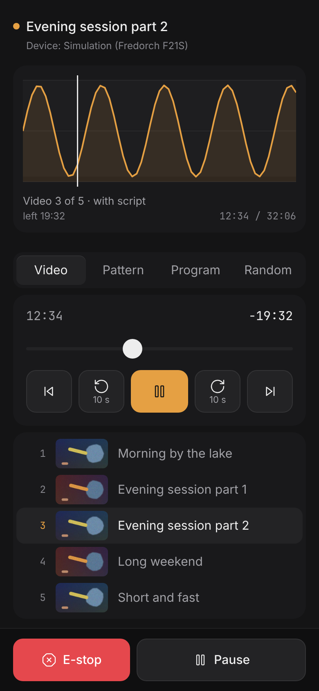

### Reset

Wherever something can be adjusted, **“Default”** sits to the right of the
heading: script and analysis options, device (playback, safety), and in the
pattern control tempo/depth, random and music. A **double click on a slider**
resets just that one.

## Pattern control (without a video)

**Pattern** in the toolbar or **Ctrl+M** opens the pattern control. It plays
patterns directly on the device, without a video and without a script.


- **On the left** the library with previews: over 50 ready-made patterns in the
  groups Basics, Rhythm, Build-up, Teasing, More rhythm, More build-up and
  Intense, below them your own. At the top you switch between **Pattern**,
  **Programs**, **Random** and **Music**. A double click starts.
- Only two sliders: **Depth** (how far in it goes, 10–100 %) and **Tempo**
  (strokes per minute). Both apply to all patterns and are remembered. You can
  change them any time, while playing too, and the device does not jump. Stroke
  range, direction and tempo limit from the device window apply as well.
- **Keys**: ↑/↓ depth, ←/→ tempo (5 each), Space start/stop, Page↑/↓
  previous/next pattern.
- **Controller** (Xbox, PlayStation and others, via USB or Bluetooth): detected
  automatically while the pattern control is open, even if another window is in front.

  | Button | Function |
  |---|---|
  | A / ✕ or Start | start/stop |
  | B / ○ | stop |
  | left stick ↕ | depth, stepless |
  | right stick ↕ | tempo, stepless |
  | d-pad ↕ / ↔ | depth / tempo in steps of 5 |
  | LB / RB (L1 / R1) | previous/next pattern |

- **Start/Stop**. Esc, closing the window, playing a video or a controller lost
  during control stops the pattern at once.

**Your own patterns (building blocks):** **New**, or **Change as a copy** on a
template. Click building blocks such as Full stroke, Short at the top, Tremble,
Getting faster or Pause at the top; they are appended at the end. Each block has:

| Field | Meaning |
|---|---|
| Type | *Stroke* (down and up), *Move* (one movement to a position), *Hold* (stay there) |
| Repeats | how often the stroke comes |
| Tempo | 1× = one stroke at the set tempo, 2× twice as fast |
| Depth | from–to in percent of the set depth (0 = all the way in, 100 = all the way out) |
| Ramp | tempo and depth change evenly over the repeats |

Change the order with the arrows or by dragging. The picture below shows the
result, the selected block highlighted. Your own patterns are kept in
`~/.config/video-to-funscript/patterns.json`. All patterns are also offered by
**Insert rhythm** (Ctrl+T) in the editor, so a pattern goes straight into a script.

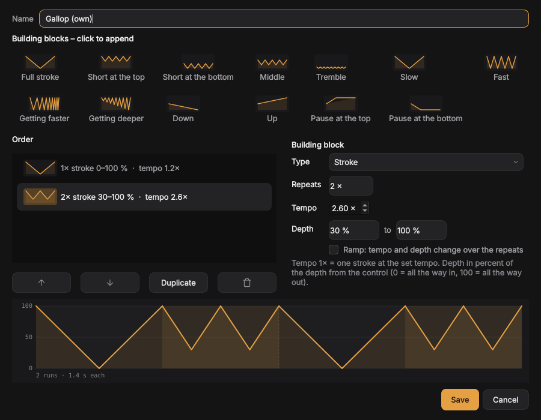

### Programs (e.g. one hour)

A **program** plays several steps one after the other. Each step has a pattern,
a **duration** in minutes and its own **tempo** and **depth**. Templates: “One
hour”, “Short and sharp (15 min)”, “Slow build-up (30 min)” and “Endless
teasing” (loop).

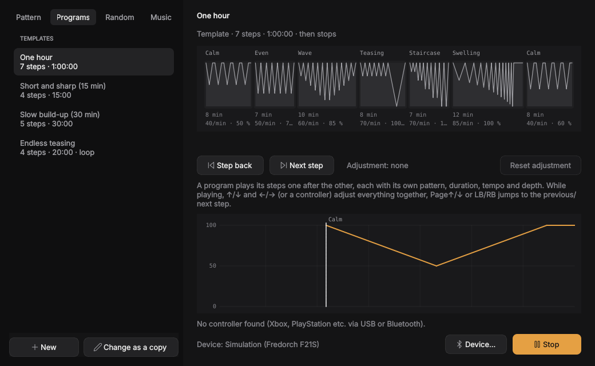

- The timeline shows all steps with their pattern, the width matches the
  duration. The line shows where you are; step, tempo, depth and the time left
  are shown below.
- While playing, ↑/↓ and ←/→ (or the controller) shift depth and tempo of the
  **whole** program, e.g. everything 10 strokes/min faster. “Reset adjustment”
  takes that back. Page↑/↓ or LB/RB jumps to the previous/next step.
- **New** or **Change as a copy** opens the editor: add steps, sort them and
  choose pattern, duration, tempo and depth per step.
- **Shorten a pattern**: with **Part** a step plays only part of the pattern,
  e.g. only building block 1 of “Almost there” (the fast start). The picture
  highlights the chosen part.
- **Smooth transitions**: tempo and depth glide over from the previous step in
  the first 8 seconds of a step instead of switching hard.
- **Start over at the end**: otherwise the device stops at the end.

Your own programs are kept in `~/.config/video-to-funscript/programs.json`.

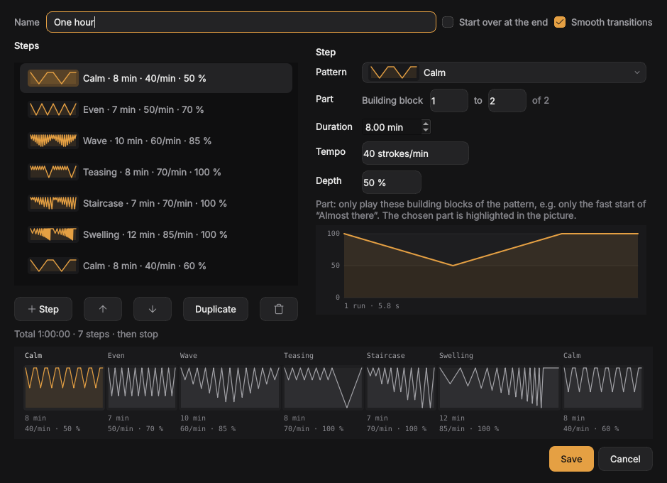

### Random and music

- **Random**: changes pattern and tempo by itself, never the same pattern twice
  in a row, sometimes only part of one. Each section is **rolled live** when its
  turn comes. Everything can be changed while playing:
  - A new **mood** (Calm, Mixed, Intense or **Everything** with all patterns)
    switches to a new section at once.
  - A new **tempo range** pulls the running section into it right away.
  - The **depth** is a slider as with patterns and programs. With “Vary the depth
    slightly” each section gets 70–100 % of it, unticked it applies exactly. The
    patterns themselves (Wave, Staircase, …) bring variety in depth.
  - The **change time** (e.g. every 1–3 minutes) applies from the next section.
  - “Roll again”, Page↓ or RB jumps on at once.

  The mood can be changed from the phone too.
- **Music**: the device follows the beat of the music playing on the PC
  (Spotify, YouTube, …) or of what the microphone hears. The app detects the
  beats, estimates the tempo and predicts the next beats, so the device is at the
  bottom on time despite the delay. Adjustable: a stroke on every, every 2nd or
  4th beat, sensitivity, depth and whether the depth follows the volume.
  Recording uses `parec` or `pw-record`, normally already installed on Nobara.
- **Script from music** (Edit → Script from music): for videos where music sets
  the beat. Puts a stroke on every beat of the audio track, for the whole video
  or the selected points, with undo.

## Command line

```bash
vtf analyze video.mp4                      # creates video.funscript
vtf analyze video.mp4 --sensitivity 70 --roi 0.2 0.1 0.6 0.8
vtf batch ~/Videos                         # a whole folder, already analysed ones skipped
vtf batch ~/Videos --overwrite --opencl
vtf info                                   # check FFmpeg/OpenCL
vtf analyze --help                         # all options
```

## Building the AppImage yourself

```bash
sudo dnf install squashfs-tools   # mksquashfs, usually installed
./scripts/build-appimage.sh       # creates dist/Video-to-Funscript-<version>-x86_64.AppImage
```

The build needs no downloads apart from the Python packages: the AppImage
runtime is in `packaging/` (see [packaging/RUNTIME.md](packaging/RUNTIME.md)).

The GitHub action `appimage` builds the AppImage on every push to `main` and on
every PR and tests it (analyses a video, takes a screenshot).

**Making a release:** raise the version in `src/vtf/__init__.py` and
`pyproject.toml` and merge. Then on GitHub start Actions → appimage → “Run
workflow” with “release” ticked on `main` (or push a tag like `v0.2.0`). The
action creates the tag, stops if the version exists already, and publishes
`Video-to-Funscript-x86_64.AppImage` and `SHA256SUMS`. Installed copies then
update themselves.

## How the analysis works

1. FFmpeg decodes the video scaled down in greyscale. With VAAPI (AMD/Intel) the
   graphics card decodes *and* scales, only the small analysis frames go to the
   CPU. If that does not work (e.g. a codec the card does not support), it falls
   back to CPU decoding automatically. Help → “Test decoding…” shows which way
   works for a video and how fast. The “GPU usage” in system monitors usually
   shows only the 3D unit; decoding runs in the video block (VCN), visible e.g.
   with `amdgpu_top`. The tracking itself is computed by the CPU.
2. For every pair of frames OpenCV computes the dense optical flow (Farnebäck).
   The global camera movement (median) is subtracted, and a motion vector is
   formed from the pixels that move most.
3. The speed is projected onto the chosen axis and summed up to a position,
   drift is removed, then it is smoothed and normalised.
4. Highs and lows (with hysteresis = sensitivity) become funscript points. The
   threshold follows the strokes of the last second, so small strokes right next
   to big ones are not missed. The moment of each turning point is computed
   between two frames (to a few milliseconds instead of a whole frame).

With **tracking**, step 2 is replaced by following the marked areas: up to 60
feature points per area are tracked with Lucas-Kanade, a forward-backward check
drops points that slipped, and the area moves by the median of the rest. Points
are taken only inside an outline, with an inset from its edge. With fast strokes
the search starts where the last movement points (prediction), so the box stays
on even with big jumps between two frames. Every few frames the look is
compared and the area pulled back (with sub-pixel precision) if it drifted. If
it reaches over the image edge or is blurred by fast movement, this comparison
does not count as occlusion. The stretch outside the picture or under an
occlusion is bridged with a cubic curve that takes over the speed at both ends.
With longer gaps the curve goes through the spots where the AI check saw the
body part. The AI check remembers at marking time which body points lie in the
box and where its centre lies from each of them, measured in body heights, so
it still fits when the person comes closer.

Since steps 1–2 (expensive) are separate from 3–4 (cheap), script settings apply
at once without a new analysis.

## Design

The interface follows a fixed design direction (an edit bay at night, one accent
for the script only), made with the method of
[unslop](https://github.com/heydamir/unslop). Details are in
[docs/design.md](docs/design.md) (German).

## Development

```bash
.venv/bin/pytest
```

How precise the tracking is, `python tools/measure_tracking.py` measures:
synthetic videos with known movement (getting faster, small strokes, big and
small in turn, little texture, pauses, fast strokes, half and fully out of the
picture), with the tracking error in pixels, deviation of the turning points in
ms, stroke height, missed and false points. `--shake 0.5` adds tremble,
`--width` changes the analysis width, `--only "aus dem Bild"` measures only
matching scenes (the scene names are German), `--seed` picks other textures.

**Screenshots**: `tools/screenshots/run.sh WORKDIR [PERSON_VIDEO]` recreates every
picture in `docs/images/` in both languages from synthetic demo videos (no real
footage); the AI pictures need a clip with a whole figure and the AI models.

**Translations**: the German text in the code is the key (`tr("…")`), English
is in `src/vtf/locale_en.py`. A test checks that every text has a translation
and that the fields `{0}`, `{1:.0f}` … survive. Another language is one more
file of that kind.

Project layout:

```
src/vtf/
  video.py       video info + fast decoding (FFmpeg/OpenCV)
  analysis.py    optical flow -> motion data (+ cache)
  tracking.py    follow marked areas
  autofind.py    find toy, reference and stroke direction automatically
  pose.py        AI body detection (loading models, people and points, anchors)
  generator.py   motion data -> curve -> funscript points
  quality.py     script check
  funscript.py   file format
  batch.py       folder processing
  library.py     library, ratings
  scriptdir.py   where scripts and video data are saved and found
  thumbs.py      preview pictures of the videos
  stats.py       local statistics
  i18n.py        languages (locale_en.py: English texts)
  gpu.py         OpenCL helpers
  device/        device control: simulation, Intiface (Buttplug), TCode, sync
  cli.py         command line (vtf)
  gui/           PySide6 interface (vtf-gui), design in gui/theme.py
```

The [roadmap](docs/roadmap.md) (German) collects ideas for later.

## Licence

MIT, see [LICENSE](LICENSE).
