# Video-to-Funscript Generator

Kostenlose, quelloffene Software zur **lokalen** Videoanalyse und automatischen
Erstellung von Funscripts. Keine Cloud, keine Abos, keine API-Kosten.

**→ [Anleitung: in 8 Schritten vom Video zum Script](docs/anleitung.md)**


| Tracking | Player | Gerät |
|---|---|---|
| [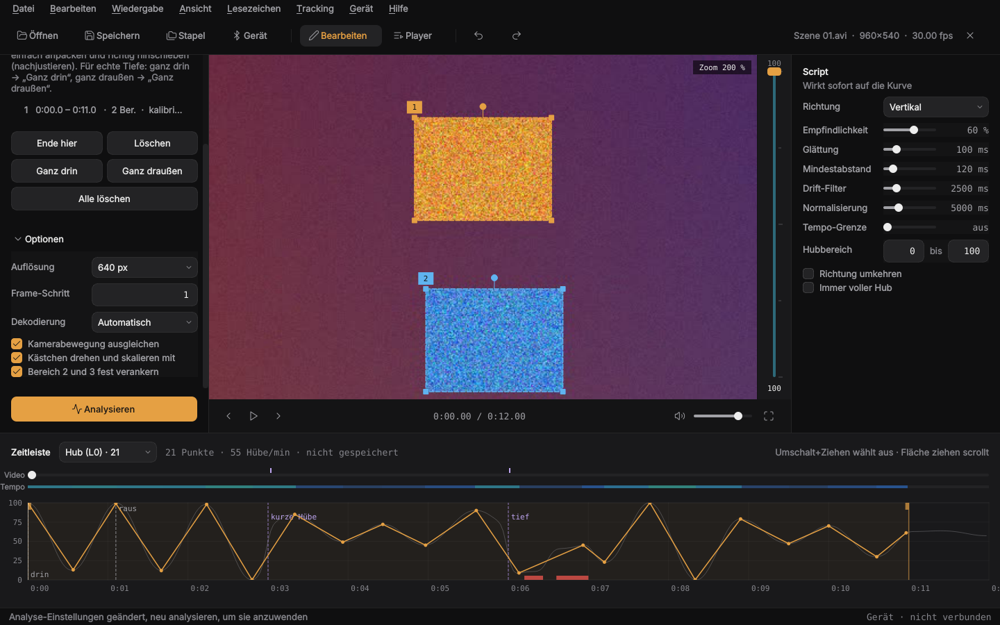](docs/tracking.png) | [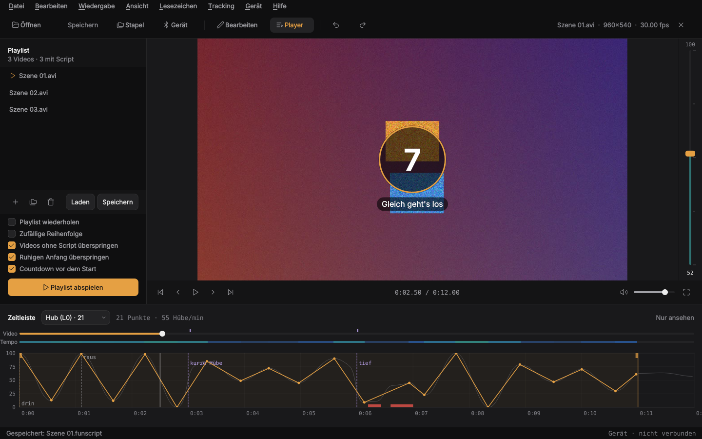](docs/player.png) | [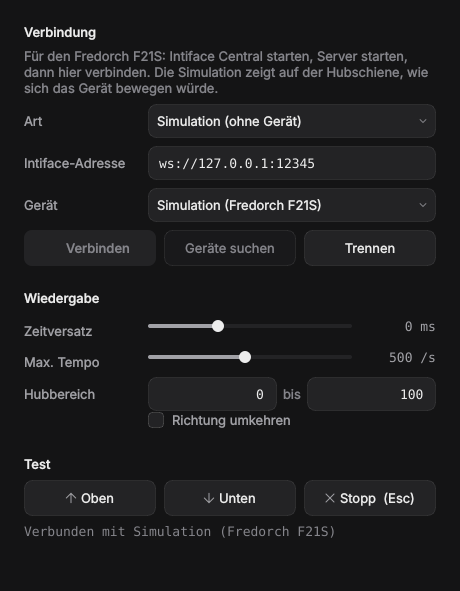](docs/device.png) |
| Kästchen markieren und zoomen, verankern, Optionen | Playlist, Countdown vor dem Start | Fredorch F21S über Intiface oder Simulation |

Entwickelt und getestet für Nobara Linux (KDE) mit AMD Ryzen 7 3700X und
Radeon RX 5700 XT – läuft aber auf jedem Linux mit Python ≥ 3.10.

## Funktionen (Stand 0.10)

| | Funktion | Status |
|---|---|---|
| 1 | Grafische Oberfläche (PySide6) | ✅ |
| 2 | Videovorschau mit Abspielen, Frame-Schritt, Suchleiste | ✅ |
| 3 | Automatische Bewegungsanalyse (dichter optischer Fluss) | ✅ |
| 4 | Bewegungsrichtung (vertikal / horizontal / automatisch) und Bewegungsumfang | ✅ |
| 5 | Einstellbare Empfindlichkeit, Glättung, Mindestabstand, Drift-Filter | ✅ (Live-Vorschau) |
| 6 | Analysekurve anzeigen und Punkte bearbeiten (inkl. Rückgängig) | ✅ |
| 7 | Funscript-Export (`<Video>.funscript` neben dem Video) | ✅ |
| 8 | Stapelverarbeitung ganzer Ordner (GUI + Kommandozeile) | ✅ |
| 9 | Bereits analysierte Videos überspringen | ✅ |
| 10 | Gerätesteuerung (Fredorch F21S über Intiface Central, Simulation) | ✅ Teil 1, Test mit echtem Gerät steht aus |
| 11 | Ton bei der Wiedergabe | ✅ |
| 12 | Player-Modus mit Playlist | ✅ |
| 13 | Tracking: markierte Körperteile/Objekte verfolgen, Abschnitte, Tiefen-Kalibrierung | ✅ |
| 14 | Editor: Mehrfachauswahl, Kopieren/Einfügen, Abschnitt glätten/verstärken | ✅ |
| 15 | Weitere Achsen (Surge, Sway, Twist, Roll, Pitch) | ✅ |
| 16 | Robusteres Tracking: drehbare Kästchen, Drift-Korrektur, Nachjustieren | ✅ |
| 17 | Stapel mit Tracking (Videos vorbereiten, dann durchlaufen lassen) | ✅ |
| 18 | Heatmap und Tempo-Grenze | ✅ |
| 19 | Layout wie ein Schnittprogramm: links Analyse, Mitte Video, rechts Script, unten Zeitleiste | ✅ |
| 20 | Verdeckung erkennen (auch durch eine Hand) und Bereich danach wiederfinden | ✅ |
| 21 | Video-Zoom zum Markieren kleiner Stellen, Kästchen direkt anpacken und korrigieren | ✅ |
| 22 | Bereiche 2/3 fest verankern, Kästchen nur verschieben (für Maschinen) | ✅ |
| 23 | Lesezeichen/Kapitel, Rhythmus-Vorlagen, Abschnitte in der Kurve ziehen | ✅ |
| 24 | Player: ruhigen Anfang überspringen, Countdown vor dem Start | ✅ |
| 25 | Muster-Steuerung: über 50 Muster, eigene aus Bausteinen, Abläufe (z.B. 1 Stunde), Controller | ✅ |
| 26 | Zufallsgenerator, Musik-Modus (Gerät folgt dem Takt), Script aus Musik | ✅ |
| 27 | Handy-Fernbedienung im Browser, Einrichtungs-Assistent, Sicherheits-Timer | ✅ |
| 28 | Andere Player (mpv, VLC, DeoVR, HereSphere), Vibratoren, TCode-Geräte (OSR2/SR6) mit allen Achsen | ✅ |
| 29 | Bildrand und kurze Verdeckungen überbrücken, KI-Körpererkennung: Kästchen-Vorschlag und KI-Kontrolle | ✅ |

## Installation als AppImage (am einfachsten)

Eine Datei, keine Installation, Python wird nicht benötigt:

1. Die neueste Version herunterladen:
   [Video-to-Funscript-x86_64.AppImage](https://github.com/conty1337/Video-to-funscript-Generator/releases/latest/download/Video-to-Funscript-x86_64.AppImage)
   (oder unter **Releases**).
2. Ausführbar machen und starten:
   ```bash
   chmod +x Video-to-Funscript-*.AppImage
   ./Video-to-Funscript-*.AppImage
   ```
   Oder in Dolphin: Rechtsklick → Eigenschaften → Berechtigungen → „Ausführbar“.
3. Beim ersten Start trägt sich die App selbst ins Startmenü ein (abschaltbar
   unter Hilfe → „Im Startmenü anzeigen“). Am besten legst du die Datei vorher
   an ihren festen Platz, z. B. `~/Applications`. Wird sie verschoben, passt
   der nächste Start den Eintrag an. Wer **Gear Lever** nutzt, bekommt keinen
   doppelten Eintrag.

**Updates kommen automatisch:** Beim Start sucht die App nach einer neuen
Version, lädt sie im Hintergrund, prüft sie per SHA-256 und ersetzt die
AppImage-Datei. Der nächste Start oder „Neu starten“ in der Statusleiste nutzt
dann die neue Version. Manuell: Hilfe → „Nach Updates suchen“, abschaltbar
über Hilfe → „Automatisch aktualisieren“. Dafür muss der Ordner mit dem
AppImage beschreibbar sein (z. B. `~/Applications`, wie bei Gear Lever).

FFmpeg und die OpenCL-Treiber kommen weiterhin vom System (siehe unten).
Ohne FFmpeg dekodiert das AppImage über das mitgelieferte OpenCV.

## Installation aus dem Quellcode (Nobara / Fedora)

```bash
sudo dnf install git python3 ffmpeg          # ffmpeg ist bei Nobara meist schon da
git clone https://github.com/conty1337/Video-to-funscript-Generator.git
cd Video-to-funscript-Generator
./install.sh
```

`install.sh` legt eine virtuelle Umgebung `.venv` an, installiert NumPy, OpenCV
und PySide6, erstellt einen **Startmenü-Eintrag** und die Befehle `vtf-gui` und
`vtf` in `~/.local/bin`.

Starten: Startmenü → „Video-to-Funscript Generator“, oder `./start.sh`.

### GPU (RX 5700 XT)

Die Software nutzt die Grafikkarte auf zwei Wegen, beides optional:

* **Hardware-Dekodierung (VAAPI)** über FFmpeg – funktioniert mit dem
  Mesa-Treiber von Nobara direkt. Einstellung „Hardware-Dekodierung“.
* **OpenCL** für den optischen Fluss (OpenCV T-API). Dafür eine
  OpenCL-Laufzeit installieren, z. B.
  `sudo dnf install mesa-libOpenCL` (Mesa rusticl, wird von `start.sh` mit
  `RUSTICL_ENABLE=radeonsi` aktiviert) oder `rocm-opencl`. Danach in der GUI
  „GPU (OpenCL)“ anhaken. `vtf info` zeigt, ob ein Gerät gefunden wurde.

Hinweis: Bei der Standard-Analyseauflösung (320 px) ist die CPU (8 Kerne) oft
genauso schnell wie OpenCL, weil das Kopieren zur GPU Zeit kostet. Bei höheren
Auflösungen lohnt sich OpenCL eher.

## Bedienung

Eine kurze Schritt-für-Schritt-Anleitung steht in
[docs/anleitung.md](docs/anleitung.md). Hier alle Funktionen im Einzelnen.

**Aufbau**: links die Analyse (Methode, Tracking, Optionen, „Analysieren“),
in der Mitte das Video mit der Hub-Leiste, rechts die Script-Einstellungen,
unten die Zeitleiste mit den Spuren Video, Tempo und Kurve. Ansicht →
Strg+1 / Strg+2 klappt die linke bzw. rechte Leiste ein. Strg+W schließt das
Video.

1. Video öffnen (Strg+O oder per Drag & Drop).
2. Optional: im Vorschaubild ein Rechteck um den relevanten Bereich ziehen
   (ROI). Rechtsklick entfernt die ROI. Das verbessert die Erkennung deutlich.
3. **Analysieren** klicken. Die Rohdaten werden zwischengespeichert
   (`~/.cache/video-to-funscript`), eine erneute Analyse desselben Videos mit
   denselben Einstellungen ist sofort fertig.
4. Script-Einstellungen anpassen – die Kurve aktualisiert sich sofort:
   * **Empfindlichkeit**: höher = auch kleine Bewegungen werden zu Punkten.
   * **Glättung**: entfernt Zittern.
   * **Mindestabstand**: kleinster zeitlicher Abstand zwischen zwei Punkten.
   * **Drift-Filter**: entfernt langsames Wegdriften der Position.
   * **Normalisierung**: Fenster, in dem der Hub auf den vollen Bereich
     skaliert wird (0 = über das ganze Video).
   * **Bewegungsumfang**: minimale/maximale Position (0–100).
   * **Umkehren** / **Immer voller Hub**.
5. Punkte bearbeiten: ziehen = verschieben, Doppelklick = neuer Punkt,
   Rechtsklick oder Entf = löschen, Mausrad = Zoom, Klick in die Kurve = zu
   dieser Stelle springen. Strg+Z / Strg+Umschalt+Z.
   **Mehrere Punkte**: Umschalt- oder Strg+Ziehen auf freier Fläche zieht ein
   Auswahlrechteck, Strg+Klick schaltet einzelne Punkte um, Strg+A wählt alle.
   Ausgewählte Punkte werden zusammen verschoben. Strg+X/C/V schneidet aus,
   kopiert und fügt an der Abspielposition ein (auch in ein anderes Video),
   Strg+G glättet die Auswahl, Strg+↑/↓ verstärkt oder schwächt den Hub.
   Kurve verschieben: freie Fläche ziehen (oder mittlere Maustaste), die
   Scrollleiste darunter, Umschalt+Mausrad oder waagrecht wischen (Touchpad).
   Video-Zeitleiste: Klick springt direkt an die Stelle und lässt sich gleich
   weiterziehen, Mausrad = 1 s vor/zurück.
6. **Strg+S** speichert `<Video>.funscript` neben dem Video – so finden es
   Player automatisch.

**Ton**: Beim Abspielen läuft der Ton des Videos mit, synchron zum Bild und
zum Gerät. Lautsprecher-Knopf oder **M** schaltet ihn stumm, der Regler daneben
stellt die Lautstärke ein. Beides merkt sich die App.

**Tracking** (genauer bei unruhigen Videos): In den Analyse-Einstellungen
„Methode: Tracking“ wählen, an eine Stelle spulen, wo alles gut zu sehen ist,
und im Video bis zu 3 Bereiche aufziehen, z.B. um die beiden Körperteile.
Jeder Bereich wird mit vielen Bildpunkten verfolgt.
* 1 Bereich: dessen Bewegung (Kamerabewegung wird abgezogen).
* 2–3 Bereiche: Bereich 1 relativ zu den anderen. Dann spielt die Kamera keine
  Rolle mehr, auch Zoom und Schwenks stören kaum.

*Abschnitte*: Das Markieren startet einen Abschnitt an dieser Stelle. **Ende
hier** (Taste E) beendet ihn, z.B. wenn die Szene vorbei ist. Nach einem
Szenenwechsel einfach an der neuen Stelle wieder markieren, dann beginnt dort
ein neuer Abschnitt. Nur in Abschnitten entstehen Punkte. Die Abschnitte stehen
als Liste in den Einstellungen (Klick springt zum Start) und als helle Bänder in
der Kurve. Rechtsklick ins Video löscht den Abschnitt an dieser Stelle.

*Tiefen-Kalibrierung*: Zu einer Stelle spulen, wo es ganz drin ist, und **Ganz
drin** (Taste D) klicken, dann zu einer Stelle ganz draußen und **Ganz
draußen** (Taste A). Ab dann nutzt das Script in diesem Abschnitt den echten
Abstand der Bereiche: ganz drin = 0, ganz draußen = 100, kurze Hübe bleiben kurz.
Ohne Kalibrierung wird jeder Hub auf den vollen Bereich gestreckt. Die
Kalibrierung wirkt sofort, ohne neue Analyse.

Beim Abspielen zeigt die Vorschau, wo die Bereiche gerade sind.

*Kästchen anpassen*: Am Start eines Abschnitts (Klick in der Liste) innen
ziehen = verschieben, an einer Ecke = Größe, am runden Griff oder mit dem
Mausrad = drehen (Umschalt = feinere Schritte). Kleine Stellen: **Strg+Mausrad**
zoomt ins Video, die mittlere Maustaste verschiebt den Ausschnitt, Strg+0
setzt zurück. Bei sehr kleinen Kästchen erinnert die Statuszeile an eine
höhere Analyse-Auflösung (Standard 640 px).

*Optionen* (links, eingeklappt): Auflösung, Frame-Schritt, Dekodierung,
Kamerabewegung ausgleichen, **Kästchen drehen und skalieren mit** (aus für
Maschinen und starre Teile: die Kästchen verschieben sich dann nur) und
**Bereich 2 und 3 fest verankern** (sie bleiben, wo sie markiert sind, und
gehen nur mit der Kamera mit, nichts kann sie wegziehen; bei Kamerafahrten
aus).

*Wandernde Kästchen und Verdeckung*: Das Tracking prüft auf unmögliche
Sprünge und gleicht alle paar Bilder mit dem Aussehen beim Markieren (und bei
jeder Korrektur) ab, auch gedreht und skaliert. Schiebt sich etwas davor,
auch nur teilweise wie eine Hand, springt der Bereich an die letzte sichere
Stelle zurück, wird rot und wartet, bis er wieder zu sehen ist. Rote Stellen
in der Kurve: dort war ein Bereich verdeckt oder verloren, dort entstehen
keine Hübe. Geht etwas über den **Bildrand**, folgt das Kästchen dem
sichtbaren Rest, bis weniger als 40 % davon im Bild sind. Dann wartet es am
Rand und wird wiedergefunden, sobald es zurückkommt. Die Strecke draußen
(bis 2,5 s) wird aus der Bewegung beim Verlassen und beim Zurückkommen
weitergerechnet, so landet auch der Wendepunkt außerhalb des Bildes im Script.
Kurze Verdeckungen (bis 1 s, z.B. eine Hand, die drüberwischt) werden genauso
überbrückt, auch die Bilder kurz davor, in denen das Kästchen schon mitgezogen
wurde. Liegt ein Kästchen trotzdem daneben: an der Stelle **anpacken und
richtig hinschieben** (*nachjustieren*). Nach der nächsten Analyse folgt der
Bereich von dort aus, und die Strecke davor wird rückwärts verfolgt und
ausgeglichen. Anfang und Ende eines Abschnitts lassen sich in der Kurve mit
der Maus verschieben.

**KI-Körpererkennung** (optional, lokal, ohne Internet nach dem ersten Laden,
Schritt für Schritt mit Bildern in der [Anleitung](docs/anleitung.md#kästchen-mit-der-ki)):

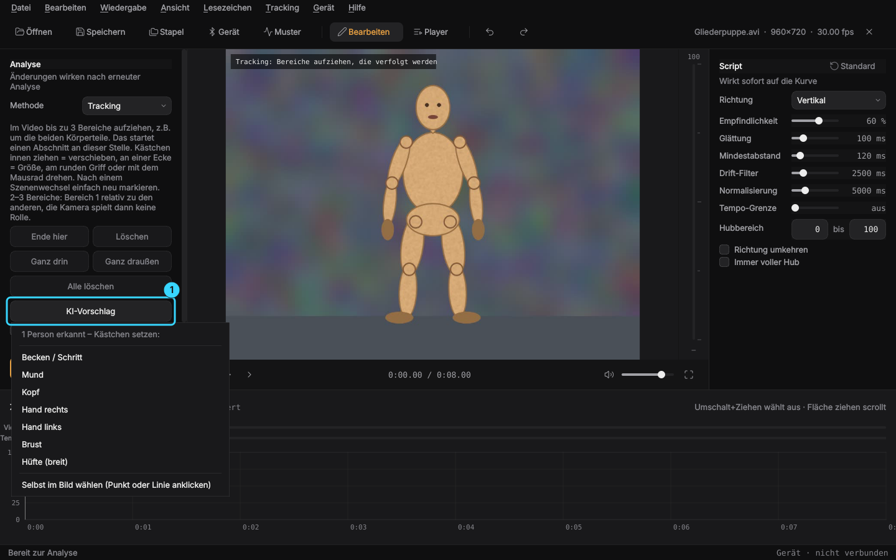

- **KI-Vorschlag** (Taste K): erkennt die Personen im aktuellen Bild und bietet
  Kästchen für Becken/Schritt, Hüfte, Mund, Kopf, Brust und beide Hände an. Ein
  Klick setzt das Kästchen, danach wie gewohnt anpassen. Gleichzeitig zeigt
  die KI ihr **Gerüst** im Video (Gelenke, Linien, Hände mit Fingern). Ein
  Klick auf einen Punkt setzt dort ein Kästchen, ein Klick auf eine Linie (z.B.
  Oberschenkel) ein gedrehtes Kästchen entlang der Linie.
- **KI-Kontrolle beim Verfolgen** (Häkchen unter dem Knopf): Während der Analyse
  prüft die Körpererkennung etwa jede Sekunde, bei Unsicherheit alle drei Bilder,
  ob jedes Kästchen noch auf dem Körperteil sitzt, auf das es gesetzt wurde.
  Rutscht es weg, wird es zurückgeholt. Liegt länger eine Hand darauf, wartet das
  Kästchen dort, wo die KI das Körperteil sieht, und die Strecke wird durch diese
  Stellen überbrückt (einzelne Ausreißer der KI werden dabei verworfen). Kostet
  Zeit: Eine Prüfung mit Personensuche dauert etwa 0,5 s auf der CPU, die
  häufigen Zwischenblicke suchen die Person dort, wo sie gerade war, und
  brauchen etwa ein Drittel davon. Im Härtefall (10 s Hand auf dem Becken)
  bleibt der Fehler unter 10 px statt 200 px, fast alle Hübe sind im Script.
- **Modelle**: YOLOX-m (findet Personen) und RTMW-l (133 Körperpunkte mit Händen,
  Füßen und Gesicht) von OpenMMLab, Lizenz Apache-2.0, zusammen etwa 310 MB
  Download (330 MB auf der Platte). Sie werden beim ersten Benutzen nach
  Rückfrage geladen, die Prüfsummen werden kontrolliert, und sie liegen danach
  unter `~/.local/share/video-to-funscript/models`. Sie laufen über OpenCV, das
  schon in der App steckt, das AppImage wird dadurch nicht größer.
- Gut bei ganzen Körpern und halbnahen Einstellungen. Bei sehr nahen
  Ausschnitten, in denen kaum Körperpunkte zu sehen sind, findet die KI nichts.
  Dann gibt es keinen Vorschlag, und die Kontrolle bleibt für dieses Kästchen aus.

*Vorbereitung*: Bereiche, Abschnitte und Kalibrierung werden sofort als
`<Video>.vtf.json` neben dem Video gespeichert und beim nächsten Öffnen
geladen. Strg+Bild↓ / Strg+Bild↑ öffnet das nächste/vorige Video im Ordner,
so lassen sich viele Videos schnell vorbereiten. Die Stapelverarbeitung nutzt
die Vorbereitung, Videos ohne sie laufen mit „Bewegung im Bild“.

**Weitere Achsen**: Über der Kurve wählst du die Achse: Hub (L0), Surge (L1),
Sway (L2), Twist (R0), Roll (R1) oder Pitch (R2). Jede Achse hat eigene Punkte
und wird beim Speichern als `<Video>.roll.funscript` usw. neben dem Video
abgelegt, wie es Mehrachsen-Player (MultiFunPlayer, OFS) erwarten.
Bearbeiten → „Weitere Achsen aus Analyse erzeugen“ berechnet Sway aus der
seitlichen Bewegung und Roll aus dem Winkel zwischen den Tracking-Bereichen 1
und 2. Twist und Pitch setzt du von Hand. Der Fredorch F21S hat nur eine Achse,
das Gerät folgt deshalb immer „Hub“.

**Player-Modus**: Oben auf **Player** (Strg+P). Die Seitenleiste zeigt dann die
Playlist: Videos oder Ordner mit + hinzufügen oder hineinziehen, per Ziehen
umsortieren, Entf entfernt. Abgespielt wird jeweils das Funscript neben dem
Video, auf dem verbundenen Gerät, eins nach dem anderen. Optionen:
wiederholen, zufällige Reihenfolge, Videos ohne Script überspringen. Bild ↑/↓
springt zum vorherigen/nächsten Video, F11 schaltet Vollbild (Esc beendet es,
zusammen mit dem Not-Aus). Playlists lassen sich als `.m3u` laden und
speichern, die letzte merkt sich die App. Ein ruhiger Anfang wird übersprungen
(Start 10 s vor dem ersten Hub), und in den letzten 10 s vor dem Start zählt
ein Countdown herunter. Beides ist abschaltbar.

**Lesezeichen und Rhythmus**: B setzt ein Lesezeichen mit Namen, Alt+→/←
springt zum nächsten/vorigen, das Menü „Lesezeichen“ listet alle. Sie stehen
in Kurve und Zeitleiste und werden in `<Video>.vtf.json` gespeichert.
Strg+T („Rhythmus einfügen“) füllt einen Bereich mit einem Takt: gleichmäßig,
schneller oder langsamer werdend, Doppelschlag oder Wellen, mit Tempo und Tiefe.

**Heatmap und Tempo-Grenze**: Die Tempo-Spur in der Zeitleiste und die Farbe der
Hub-Leiste neben dem Video zeigen das Tempo des Scripts (dunkel = langsam, grün, gelb, rot = schnell). Mit
**Tempo-Grenze** (Script-Einstellungen) werden zu schnelle Hübe schon beim
Erzeugen gekürzt. Für den F21S passt etwa 500 /s (voller Hub in ca. 200 ms).

**Stapelverarbeitung**: Datei → Stapelverarbeitung (Strg+B) oder einen Ordner
ins Fenster ziehen. Es werden die aktuellen Einstellungen verwendet. Videos, für
die schon ein `.funscript` existiert, werden übersprungen (abschaltbar).

## Gerät steuern (Phase 2)

Die App spielt das Script synchron zum Video auf einem Gerät ab. Die
Bluetooth-Verbindung übernimmt **[Intiface Central](https://intiface.com/central/)**
(kostenlos, Open Source, für Linux als AppImage). Es unterstützt den
**Fredorch F21S** über sein Protokoll „fredorch“, das Gerät meldet sich als
`YXlinksSPP`.

1. Intiface Central starten und auf **„Start Server“** klicken (Adresse
   `ws://127.0.0.1:12345`).
2. Gerät einschalten. Die Hersteller-App am Handy darf nicht verbunden sein,
   das Gerät erlaubt nur eine Verbindung.
3. In dieser App: **Gerät** (Toolbar oder Strg+D) → Art „Intiface Central“ →
   **Verbinden**. Die App startet die Gerätesuche, und das Gerät erscheint in der Liste.
4. Mit **Oben/Unten** testen, dann das Video abspielen: Das Gerät folgt dem Script.

**Am einfachsten beim ersten Mal:** Gerät → **Einrichtungs-Assistent**. Er führt
durch Verbinden, Richtung, Hubbereich, Höchsttempo (4 Hübe zum Ausprobieren
pro Stufe) und Verzögerung. Für die Verzögerung leuchtet ein Kreis im Takt auf
und klickt, das Gerät soll genau dann unten sein. Den Regler schiebst du, bis
es passt.

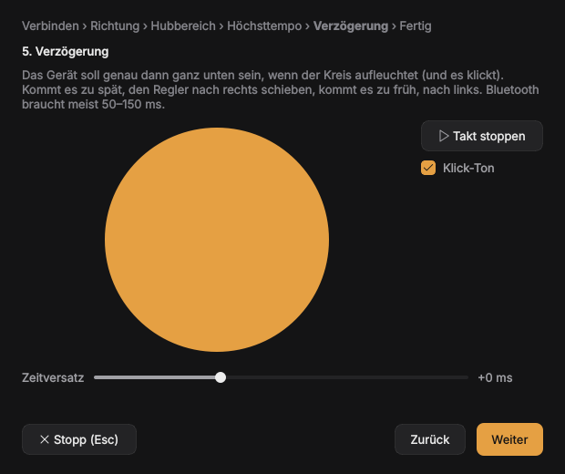

Ohne Gerät: Art **„Simulation“**. Die Hubschiene neben dem Video zeigt mit
einer weißen Umrandung, wo das Gerät gerade wäre. Die Simulation bildet den
F21S nach: 16 Positionen, voller Hub frühestens in etwa 200 ms.

Einstellungen im Geräte-Dialog:

- **Zeitversatz**: gleicht die Bluetooth-Verzögerung aus. Positiv heißt, das Gerät
  bekommt seine Befehle früher. Startwert 0, typisch 50–150 ms.
- **Max. Tempo**: Hübe, die schneller wären, werden verkürzt, nicht verzögert.
  So bleibt das Gerät synchron und wird geschont.
- **Hubbereich**: welcher Teil des Gerätewegs genutzt wird (Tiefe).
- **Richtung umkehren**.

**Sicherheit:** Bei Pause, Spulen, Schließen und mit **Esc (Not-Aus)** stoppt
das Gerät sofort. Nach Start oder Spulen fährt es zuerst langsam zur aktuellen
Script-Position und folgt erst dann.

**Sicherheits-Timer** (im Fenster „Gerät“, standardmäßig aus): stoppt nach
einer Höchstdauer am Stück, stoppt, wenn so lange nichts bedient wurde
(Taste, Maus, Controller, Handy), und macht auf Wunsch alle paar Minuten eine
kurze Pause, danach geht es von selbst weiter. Jeder Wert ist einzeln
abschaltbar (0 = aus). Gezählt wird nur, solange sich das Gerät bewegt.

### Andere Geräte

- **Vibratoren und andere Geräte ohne Hub** über Intiface (Lovense, We-Vibe und
  hunderte mehr): Die Stärke kommt aus dem Script. Unter „Vibration folgt“
  stellst du ein, ob schnelle Hübe stark sind (**Tempo**) oder tiefe Stellen
  (**Tiefe**).
- **OSR2, SR6 und andere TCode-Geräte**: Art „OSR2/SR6 u.a. (TCode)“, als
  Adresse den USB-Port (`/dev/ttyUSB0` oder `/dev/ttyACM0`) oder
  `udp://IP:Port` für WLAN. Alle Achsen werden genutzt: Hub, Surge, Sway,
  Twist, Roll und Pitch, also auch die, die die App selbst erzeugt. Wenn der
  USB-Port nicht aufgeht: `sudo usermod -aG dialout $USER`, dann neu anmelden.

### Andere Player

Gerät → **Andere Player (mpv, VLC, VR)**: Das Gerät folgt dem Script, während du
das Video in einem anderen Player schaust. Das Script wird neben dem Video
gesucht (gleicher Name, `.funscript`) oder in einem Script-Ordner, der auch
Unterordner durchsucht.

| Player | So einschalten |
|---|---|
| mpv (am genauesten) | `mpv --input-ipc-server=/tmp/mpvsocket video.mp4` oder `input-ipc-server=/tmp/mpvsocket` in `~/.config/mpv/mpv.conf` |
| VLC | Einstellungen → Alle → Schnittstellen → Hauptschnittstellen → „Web“, unter Lua ein Passwort setzen, VLC neu starten |
| DeoVR | Einstellungen → Remote control an, Adresse = IP der Brille |
| HereSphere | Einstellungen → DeoVR Remote an, Adresse = IP der Brille |

### Handy-Fernbedienung

Gerät → **Handy-Fernbedienung** → „Fernbedienung an“. Am Handy (gleiches WLAN)
öffnest du die angezeigte Adresse im Browser, zum Beispiel
`http://192.168.0.20:8765`, und gibst die PIN ein. Eine App ist nicht nötig. Das
Handy kann Start/Stopp, **Not-Aus**, Muster/Ablauf/Zufall wählen, Tiefe und
Tempo einstellen und Schritte springen. Im Reiter **Video** ist es die
Fernbedienung für den Player: Abspielen/Pause, ±10 s, voriges/nächstes Video,
mit dem Regler an jede Stelle springen, Restzeit sehen und ein Video aus der
Playlist antippen; dazu die Script-Kurve um die aktuelle Stelle. Die PIN lässt sich jederzeit neu
erzeugen, falsche PINs sperren das Handy kurz. Klappt die Verbindung nicht,
blockiert die Firewall den Port:
`sudo firewall-cmd --add-port=8765/tcp --permanent && sudo firewall-cmd --reload`.

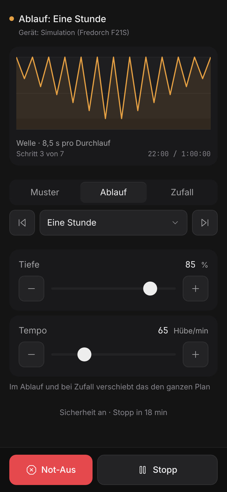 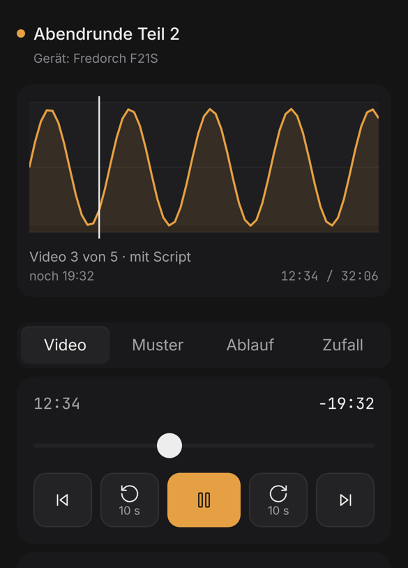

### Zurücksetzen

Wo man etwas verstellen kann, steht rechts neben der Überschrift **„Standard“**:
Script und Analyse-Optionen, Gerät (Wiedergabe, Sicherheit) sowie in der
Muster-Steuerung Tempo/Tiefe, Zufall und Musik. Ein **Doppelklick auf einen
Regler** setzt nur diesen zurück.

### Muster-Steuerung (ohne Video)

**Muster** in der Toolbar oder **Strg+M** öffnet die Muster-Steuerung. Damit
spielst du Muster direkt auf dem Gerät ab, ohne Video und ohne Script.

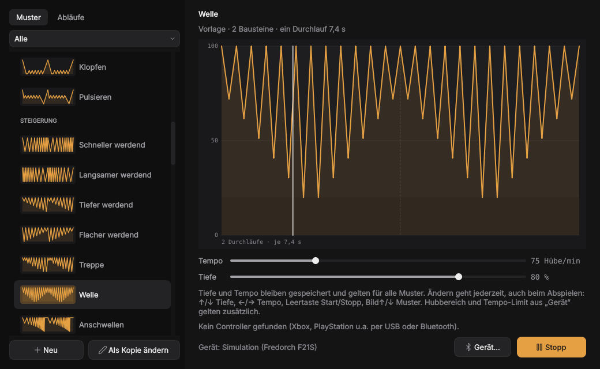

- **Links** die Bibliothek mit Vorschaubildern: über 50 fertige Muster in den
  Gruppen Grundlagen, Rhythmus, Steigerung, Necken, Mehr Rhythmus, Mehr
  Steigerung und Intensiv, darunter deine eigenen. Oben schaltest du zwischen
  **Muster** und **Abläufe** um.
  Doppelklick startet.
- Nur zwei Regler: **Tiefe** (wie weit es reingeht, 10–100 %) und **Tempo**
  (Hübe pro Minute). Beide gelten für alle Muster und bleiben gespeichert.
  Du kannst sie jederzeit ändern, auch beim Abspielen, das Gerät springt
  dabei nicht. Hubbereich, Richtung und Tempo-Limit aus dem Geräte-Dialog
  gelten zusätzlich.
- **Tasten**: ↑/↓ Tiefe, ←/→ Tempo (je 5), Leertaste Start/Stopp, Bild↑/↓
  voriges/nächstes Muster.
- **Controller** (Xbox, PlayStation und andere, per USB oder Bluetooth): wird
  automatisch erkannt, solange die Muster-Steuerung offen ist, auch wenn ein
  anderes Fenster vorne ist.

  | Taste | Funktion |
  |---|---|
  | A / ✕ oder Start | Start/Stopp |
  | B / ○ | Stopp |
  | linker Stick ↕ | Tiefe stufenlos |
  | rechter Stick ↕ | Tempo stufenlos |
  | Steuerkreuz ↕ / ↔ | Tiefe / Tempo in 5er-Schritten |
  | LB / RB (L1 / R1) | voriges/nächstes Muster |

- **Start/Stopp**. Esc, Schließen des Fensters, Abspielen eines Videos oder ein
  Controller, der während der Steuerung verloren geht, stoppt das Muster sofort.

**Eigene Muster (Baukasten):** **Neu** oder bei einer Vorlage **Als Kopie
ändern**. Bausteine wie Voller Hub, Kurz oben, Zittern, Schneller werdend oder
Pause oben anklicken, sie werden hinten angehängt. Jeder Baustein hat:

| Feld | Bedeutung |
|---|---|
| Art | *Hub* (runter und rauf), *Fahren* (eine Bewegung zu einer Position), *Halten* (dort bleiben) |
| Wiederholen | wie oft der Hub kommt |
| Tempo | 1× = ein Hub im eingestellten Tempo, 2× doppelt so schnell |
| Tiefe | von–bis in Prozent der eingestellten Tiefe (0 = ganz rein, 100 = ganz raus) |
| Verlauf | Tempo und Tiefe ändern sich gleichmäßig über die Wiederholungen |

Die Reihenfolge änderst du mit den Pfeilen oder per Ziehen. Unten zeigt das
Bild das Ergebnis, der gewählte Baustein ist hervorgehoben. Eigene Muster
liegen in `~/.config/video-to-funscript/patterns.json`. Alle Muster gibt es
auch beim **Rhythmus einfügen** (Strg+T) im Editor, so kommt ein Muster
direkt ins Script.

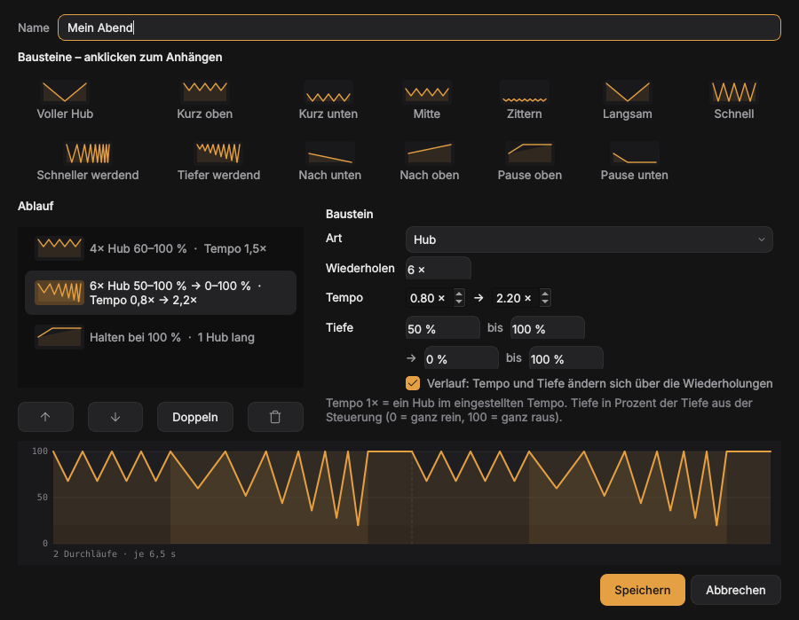

### Abläufe (z.B. eine Stunde)

Ein **Ablauf** spielt mehrere Schritte nacheinander. Jeder Schritt hat ein
Muster, eine **Dauer** in Minuten und ein eigenes **Tempo** und eine eigene
**Tiefe**. Vorlagen: „Eine Stunde“, „Kurz und knackig (15 min)“,
„Langsam steigern (30 min)“ und „Necken ohne Ende“ (Schleife).

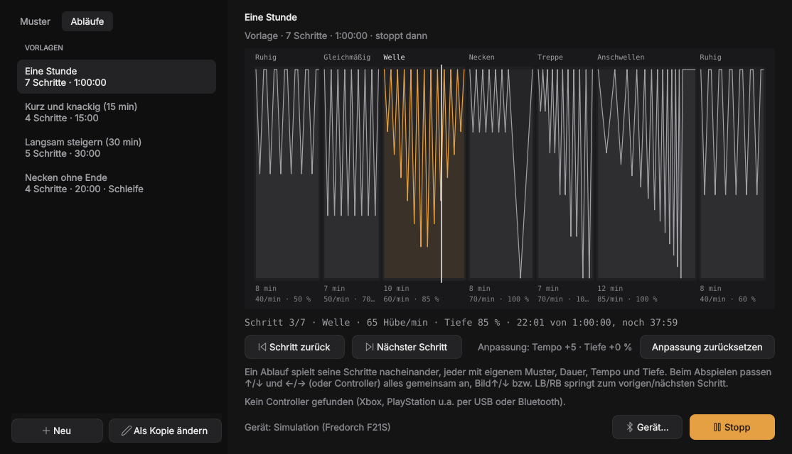

- Die Zeitleiste zeigt alle Schritte mit ihrem Muster, die Breite entspricht
  der Dauer. Der Strich zeigt, wo du bist, darunter stehen Schritt, Tempo,
  Tiefe und die Restzeit.
- Beim Abspielen verschieben ↑/↓ und ←/→ (oder der Controller) Tiefe und Tempo
  des **ganzen** Ablaufs, z.B. alles 10 Hübe/min schneller.
  „Anpassung zurücksetzen“ nimmt das zurück. Bild↑/↓ bzw. LB/RB springt zum
  vorigen/nächsten Schritt.
- **Neu** oder **Als Kopie ändern** öffnet den Editor. Dort fügst du Schritte
  hinzu, sortierst sie und wählst pro Schritt Muster, Dauer, Tempo und Tiefe.
- **Muster kürzen**: Mit **Teil** spielt ein Schritt nur einen Teil des Musters,
  z.B. von „Kurz vor Schluss“ nur Baustein 1 (den schnellen Anfang). Das Bild
  hebt den gewählten Teil hervor.
- **Weiche Übergänge**: Tempo und Tiefe gleiten in den ersten 8 Sekunden eines
  Schritts vom vorigen Schritt her, statt hart umzuschalten.
- **Am Ende von vorne anfangen**: sonst stoppt das Gerät am Ende.

Eigene Abläufe liegen in `~/.config/video-to-funscript/programs.json`.

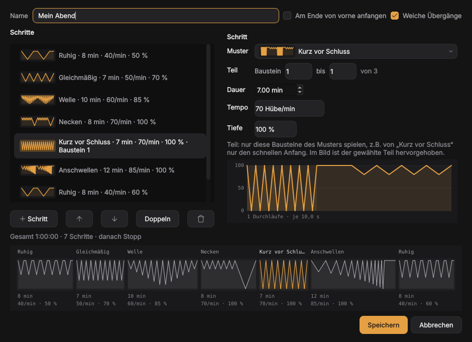

### Zufall und Musik

- **Zufall**: wechselt Muster und Tempo von selbst, nie zweimal dasselbe
  Muster hintereinander, manchmal nur ein Stück davon. Jeder Abschnitt wird
  **live gewürfelt**, wenn er drankommt. Alles lässt sich beim Abspielen ändern:
  - Eine neue **Stimmung** (Ruhig, Gemischt, Intensiv oder **Alles** mit allen
    Mustern) wechselt sofort in einen neuen Abschnitt.
  - Ein neuer **Tempo-Bereich** zieht den laufenden Abschnitt gleich mit hinein.
  - Die **Tiefe** ist ein Regler wie bei Mustern und Abläufen. Mit „Tiefe leicht
    variieren“ bekommt jeder Abschnitt 70–100 % davon, ohne Häkchen gilt sie genau.
    Für Abwechslung in der Tiefe sorgen die Muster selbst (Welle, Treppe, …).
  - Die **Wechselzeit** (z.B. alle 1–3 Minuten) gilt ab dem nächsten Abschnitt.
  - „Neu würfeln“ bzw. Bild↓/RB springt sofort weiter.

  Auch vom Handy aus lässt sich die Stimmung wechseln.
- **Musik**: Das Gerät folgt dem Takt der Musik, die gerade auf dem PC läuft
  (Spotify, YouTube, …), oder dem, was das Mikrofon hört. Die App erkennt die
  Schläge, schätzt das Tempo und sagt die nächsten Schläge voraus, so ist das
  Gerät trotz Verzögerung pünktlich unten. Einstellbar: Hub auf jeden, jeden
  2. oder 4. Schlag, Empfindlichkeit, Tiefe und ob die Tiefe der Lautstärke
  folgt. Aufgenommen wird mit `parec` oder `pw-record`, die unter Nobara
  normalerweise schon installiert sind.
- **Script aus Musik** (Bearbeiten → Script aus Musik): Für Videos, bei denen
  Musik den Takt vorgibt. Setzt auf jeden Schlag in der Tonspur einen Hub,
  für das ganze Video oder die markierten Punkte, mit Rückgängig.

## Kommandozeile

```bash
vtf analyze video.mp4                      # erzeugt video.funscript
vtf analyze video.mp4 --sensitivity 70 --roi 0.2 0.1 0.6 0.8
vtf batch ~/Videos                         # ganzer Ordner, bereits analysierte überspringen
vtf batch ~/Videos --overwrite --opencl
vtf info                                   # FFmpeg/OpenCL prüfen
vtf analyze --help                         # alle Optionen
```

## AppImage selbst bauen

```bash
sudo dnf install squashfs-tools   # mksquashfs, meist schon installiert
./scripts/build-appimage.sh       # erzeugt dist/Video-to-Funscript-<Version>-x86_64.AppImage
```

Der Build braucht keine Downloads außer den Python-Paketen: Die AppImage-Runtime
liegt in `packaging/` (siehe [packaging/RUNTIME.md](packaging/RUNTIME.md)).

Die GitHub-Action `appimage` baut das AppImage bei jedem Push auf `main` und bei
jedem PR automatisch und testet es (Video analysieren, Screenshot).

**Release erstellen:** Version in `src/vtf/__init__.py` und `pyproject.toml`
erhöhen und mergen. Dann auf GitHub unter Actions → appimage → „Run workflow“
mit Haken bei „release“ auf `main` starten (oder einen Tag `v0.2.0` pushen).
Die Action legt den Tag an, bricht ab, wenn es die Version schon gibt, und veröffentlicht
`Video-to-Funscript-x86_64.AppImage` und `SHA256SUMS`. Installierte Versionen
aktualisieren sich daraufhin selbst.

## Wie die Analyse funktioniert

1. FFmpeg dekodiert das Video verkleinert in Graustufen. Mit VAAPI (AMD/Intel)
   dekodiert *und* verkleinert die Grafikkarte, zur CPU gehen nur die kleinen
   Analysebilder. Klappt das nicht (z.B. Codec von der Karte nicht unterstützt),
   wird automatisch auf CPU-Dekodierung zurückgefallen.
   Hilfe → „Dekodierung testen…“ zeigt, welcher Weg bei einem Video klappt und
   wie schnell. Die „GPU-Auslastung“ in Systemmonitoren zeigt meist nur die
   3D-Einheit; das Dekodieren läuft im Video-Block (VCN), sichtbar z.B. mit
   `amdgpu_top`. Das Tracking selbst rechnet die CPU.
2. Für jedes Bildpaar berechnet OpenCV den dichten optischen Fluss
   (Farnebäck). Die globale Kamerabewegung (Median) wird abgezogen und aus den
   am stärksten bewegten Pixeln ein Bewegungsvektor gebildet.
3. Die Geschwindigkeit wird auf die gewählte Achse projiziert und zu einer
   Position aufsummiert, Drift wird entfernt, geglättet und normalisiert.
4. Hoch- und Tiefpunkte (mit Hysterese = Empfindlichkeit) werden zu
   Funscript-Punkten. Die Schwelle richtet sich nach den Hüben der letzten
   Sekunde, so werden kleine Hübe direkt neben großen nicht übersehen. Der
   Zeitpunkt jedes Wendepunkts wird zwischen zwei Bildern berechnet (auf wenige
   Millisekunden statt auf ein ganzes Bild genau).

Beim **Tracking** ersetzt Schritt 2 der optische Fluss nur innerhalb der
markierten Bereiche: Bis zu 60 Merkmalspunkte je Bereich werden mit
Lucas-Kanade verfolgt, eine Vorwärts-Rückwärts-Prüfung verwirft abgerutschte
Punkte, und der Bereich bewegt sich um den Median der übrigen. Bei schnellen
Hüben beginnt die Suche dort, wohin die letzte Bewegung zeigt (Vorhersage), so
bleibt das Kästchen auch bei großen Sprüngen zwischen zwei Bildern dran. Alle paar
Bilder wird das Aussehen verglichen und der Bereich (mit Zwischenpixeln)
zurückgezogen, falls er weggedriftet ist. Ragt er über den Bildrand oder ist er
durch schnelle Bewegung verwischt, wird dieser Vergleich nicht als Verdeckung
gewertet. Die Strecke außerhalb des Bildes oder unter einer Verdeckung wird
mit einer kubischen Kurve überbrückt, die die Geschwindigkeit an beiden Enden
übernimmt. Bei längeren Lücken geht die Kurve durch die Stellen, an denen die
KI-Kontrolle das Körperteil gesehen hat. Die KI-Kontrolle merkt sich beim
Markieren, welche Körperpunkte im Kästchen liegen und wo die Mitte von jedem
aus gesehen liegt, gemessen in Körperhöhen. So passt das auch, wenn die Person
näher kommt.

Da Schritt 1–2 (teuer) von 3–4 (billig) getrennt sind, wirken
Script-Einstellungen sofort ohne neue Analyse.

## Gestaltung

Die Oberfläche folgt einer festen Gestaltungsrichtung (Schnittplatz bei Nacht,
ein Bernstein-Akzent nur für das Script). Details und Quellen stehen in
[docs/design.md](docs/design.md).

## Entwicklung

```bash
.venv/bin/pytest
```

Wie genau das Tracking ist, misst `python tools/measure_tracking.py`: künstliche
Videos mit bekannter Bewegung (schneller werdend, kleine Hübe, groß/klein im
Wechsel, wenig Muster, Pausen, schnelle Hübe, halb und ganz aus dem Bild), dazu Fehler beim Verfolgen in Pixeln, Abweichung
der Wendepunkte in ms, Hubhöhe, verpasste und falsche Punkte. `--shake 0.5`
fügt Zittern hinzu, `--width` ändert die Analysebreite, `--only "aus dem Bild"` misst nur
passende Szenen, `--seed` wählt andere Texturen.

Projektstruktur:

```
src/vtf/
  video.py       Video-Infos + schnelles Dekodieren (FFmpeg/OpenCV)
  analysis.py    Optischer Fluss -> Bewegungsdaten (+ Cache)
  tracking.py    Markierte Bereiche verfolgen
  pose.py        KI-Körpererkennung (Modelle laden, Personen und Punkte, Anker)
  generator.py   Bewegungsdaten -> Kurve -> Funscript-Punkte
  funscript.py   Dateiformat
  batch.py       Ordnerverarbeitung
  gpu.py         OpenCL-Hilfen
  device/        Gerätesteuerung: Simulation, Intiface (Buttplug), Synchronisation
  cli.py         Kommandozeile (vtf)
  gui/           PySide6-Oberfläche (vtf-gui), Gestaltung in gui/theme.py
```

## Lizenz

MIT – siehe [LICENSE](LICENSE).
