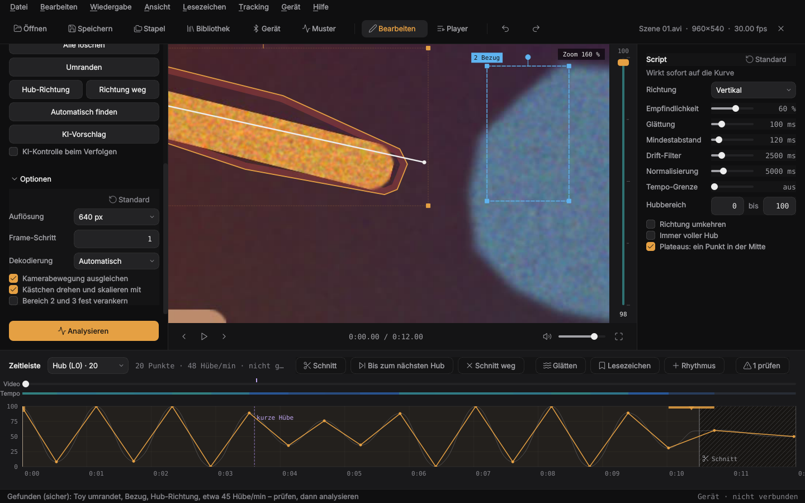
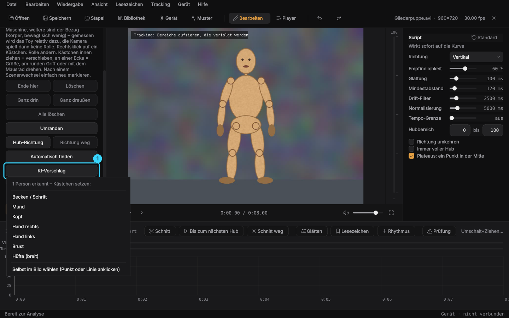
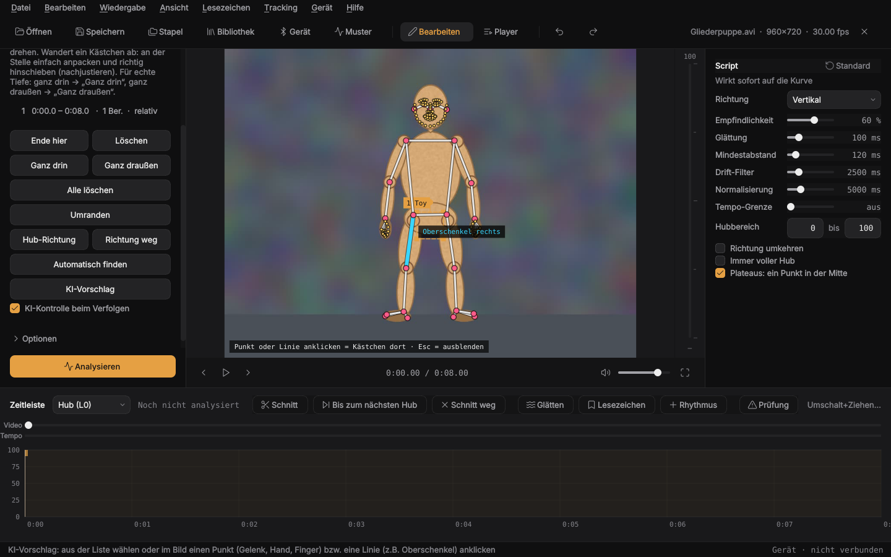
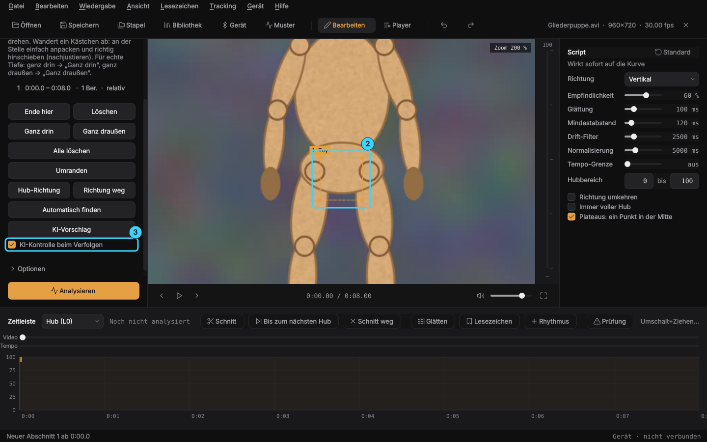
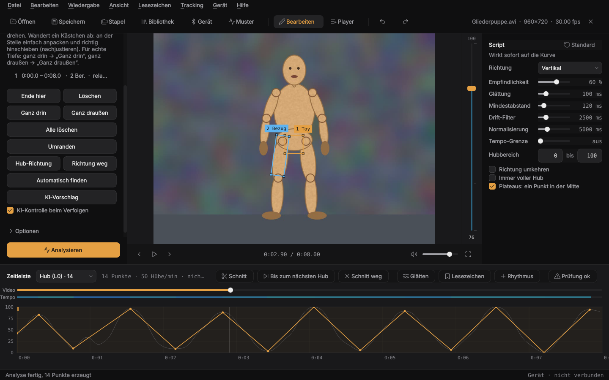

# Anleitung: vom Video zum Script

[English](guide.md) · **Deutsch**

Kurz und der Reihe nach. Die ausführliche Beschreibung aller Funktionen steht
in der [README](../README.de.md).

## Aufbau des Fensters

- **Links**: Analyse. Methode, Tracking-Abschnitte, Optionen, Knopf
  „Analysieren“. Im Player steht hier die Playlist.
- **Mitte**: das Video, rechts daneben die Hub-Leiste. Sie zeigt die
  Script-Position, ihre Farbe zeigt das Tempo.
- **Rechts**: Script-Einstellungen. Sie wirken sofort auf die Kurve.
- **Unten**: die Zeitleiste mit Video, Tempo und der Hub-Kurve zum Bearbeiten.

Strg+1 klappt die linke Leiste ein, Strg+2 die rechte.

## In 8 Schritten zum Script

1. **Video öffnen**: Strg+O oder die Datei ins Fenster ziehen. Öffnest du eine
   `.funscript`, geht das passende Video mit auf.
2. **Methode wählen** (links):
   - *Bewegung im Bild*: erkennt die stärkste Bewegung selbst. Schnell, gut
     bei ruhiger Kamera und einer klaren Bewegung.
   - *Tracking*: du markierst, was verfolgt wird. Genauer, empfohlen.
3. **Markieren** (bei Tracking): an eine Stelle spulen, wo alles gut zu sehen
   ist, und Kästchen ins Video ziehen.
   - Schneller: **Automatisch finden** (F) an einer Stelle mit gleichmäßigen
     Hüben. Die App setzt Toy (umrandet), Bezug und Hub-Richtung selbst. Danach
     kurz prüfen, ob alles sitzt, sonst anpassen wie unten.
   - **Kästchen 1** auf das Teil, das sich bewegt (im Bild „1 Toy“).
   - **Kästchen 2** (und 3) auf ein Gegenstück, das stillhält oder sich
     anders bewegt (im Bild „Bezug“, z.B. der Körper). Gemessen wird der
     Abstand zwischen 1 und den anderen, deshalb stört die Kamera dann kaum.
   - Falsch herum markiert? **Rechtsklick aufs Kästchen** → „Das ist das Toy“
     bzw. „Das ist der Körper / Bezug“. Die Nummern tauschen dann.
   - **Umranden** (Knopf oder Taste U): statt eines Rechtecks mit gedrückter
     Maustaste eng um das Toy fahren. Verfolgt wird nur, was innen liegt, mit
     ein paar Pixeln Abstand zum Rand (im Bild rot schraffiert). Gut, wenn
     direkt daneben etwas liegt, das sich anders bewegt, z.B. Finger, Hand
     oder Fuß. Rechtsklick → „Umrandung entfernen“ macht wieder ein Rechteck.
   - **Löschen**: Rechtsklick aufs Kästchen → „Bereich entfernen“, Rechtsklick
     daneben → „Abschnitt hier löschen“. Versehentlich gelöscht? **Strg+Z**
     holt es zurück (auch Rollen, Pfeile, verschobene Kästchen).
   - **Hub-Richtung** (Knopf oder Taste H): einen Pfeil entlang der
     Stoßrichtung ziehen, die Spitze zeigt nach *raus*. Gemessen wird dann nur
     entlang des Pfeils, seitliches Wackeln zählt nicht. Gut bei Maschinen, die
     schräg im Bild stoßen. Wirkt sofort, ohne neue Analyse.
   - Stellen mit **Muster oder Kanten** nehmen, keine glatten Flächen. Kein
     Hintergrund und nichts, was später verdeckt wird, mit ins Kästchen.
   - Kleine Stellen: **Strg+Mausrad** zoomt ins Video, mit gedrücktem Mausrad
     den Ausschnitt verschieben, Strg+0 setzt zurück.
   - Kästchen anpassen: innen ziehen verschiebt, eine Ecke ändert die Größe,
     der runde Griff oder das Mausrad drehen.
   - Oder die KI setzt das Kästchen, siehe [Kästchen mit der KI](#kästchen-mit-der-ki).
4. **Kalibrieren** (empfohlen): zu einer Stelle spulen, wo es *ganz drin* ist,
   und **Ganz drin** (D) drücken, dann zu *ganz draußen* und **Ganz draußen**
   (A). Dann nutzt das Script die echte Tiefe.
5. **Szenenwechsel**: dort **Ende hier** (E) drücken und an der neuen Stelle
   neue Kästchen ziehen. Damit beginnt ein neuer Abschnitt.
6. **Analysieren**: der orange Knopf unten links.
7. **Prüfen und korrigieren**: abspielen und schauen, ob die Kästchen
   mitlaufen.
   - **Rot** in der Kurve: Hier war ein Bereich verdeckt oder verloren, dort
     entstehen keine Hübe.
   - Geht etwas kurz **aus dem Bild**, ist das kein Problem: Das Kästchen
     wartet am Rand, und die Bewegung draußen wird weitergerechnet.
   - Ein Kästchen liegt daneben: an der Stelle **anpacken und richtig
     hinschieben**, dann neu analysieren. Die Zeit davor wird mit ausgeglichen.
8. **Prüfen lassen**: Orange Markierungen oben in der Kurve zeigen Stellen, die
   einen zweiten Blick wert sind (zu schnell, Lücke, Zittern, plötzlich kleine
   Hübe, Takt setzt aus, Bereich verloren). Knopf **Prüfung** in der Zeitleiste
   = Liste, **F3** springt zur nächsten Stelle. Steht dort „Prüfung ok“, musst du
   nicht das ganze Script ansehen.
9. **Speichern**: Strg+S legt `<Video>.funscript` neben das Video. Alle Scripts
   lieber (oder zusätzlich) in einem Ordner sammeln: Datei → „Einstellungen…“ → Speicherorte (dort gibt es auch einen Ordner für die Video-Daten,
   dann liegt neben den Videos nichts mehr von der App).

## Optionen (links unter „Optionen“)

| Option | Wann |
|---|---|
| Auflösung | 640 px (Standard): genauer, gut für kleine Kästchen. Kleiner ist schneller |
| Kamerabewegung ausgleichen | an lassen, wichtig bei nur einem Kästchen |
| Kästchen drehen und skalieren mit | an für Körper, **aus für Maschinen** und starre Teile |
| Bereich 2 und 3 fest verankern | an, wenn 2/3 auf festen Teilen sitzen und die Kamera ruhig ist. Dann kann nichts sie wegziehen. Bei Kamerafahrten aus |

## Script feinstellen (rechts)

| Einstellung | Wirkung |
|---|---|
| Richtung | welche Bewegung im Bild zum Hub wird (ein Hub-Richtungs-Pfeil im Abschnitt geht vor) |
| Empfindlichkeit | höher = auch kleine Hübe |
| Glättung | bügelt Zittern aus |
| Plateaus: ein Punkt in der Mitte | an: kurzes Stehenbleiben ganz drin/draußen wird ein Punkt in der Mitte |
| Mindestabstand | kürzeste Zeit zwischen zwei Punkten |
| Drift-Filter | entfernt langsames Wegwandern |
| Normalisierung | streckt leise Stellen auf vollen Hub (bei Kalibrierung egal) |
| Tempo-Grenze | kürzt zu schnelle Hübe. F21S: etwa 500 /s |
| Hubbereich | kleinster und größter Wert, z.B. 10 bis 90 |

Von Hand nachbessern: Punkte in der Kurve ziehen, Doppelklick fügt hinzu,
Rechtsklick löscht. **Strg+T** fügt einen Rhythmus oder ein Muster aus der
Muster-Steuerung für einen Bereich ein.

## Abspielen

- **Gerät**: Intiface Central starten → „Start Server“ → in der App
  **Gerät** (Strg+D) → Verbinden. Beim ersten Mal am besten Gerät →
  **Einrichtungs-Assistent**. Ohne Gerät: „Simulation“.
- **Player** (Strg+P): Videos in die Playlist ziehen, „Playlist abspielen“.
  Ein ruhiger Anfang wird übersprungen, vor dem Start zählt ein Countdown
  (Länge unter „Countdown vor dem Start“ einstellbar, 3–30 s).
  Schnitte (siehe unten) werden übersprungen, auf Wunsch auch jede Pause ohne
  Hübe ab 15 s („Pausen ohne Hübe überspringen“). Wenn es danach weitergeht,
  zählt der Countdown wie am Anfang herunter.
- **Schnitt** (im Editor): Wo nichts passiert, **X** am Anfang und **X** am
  Ende drücken, oder **Umschalt+X** = Schnitt bis zum Countdown vor dem nächsten Hub.
  Schraffiert in der Kurve; der Player springt darüber. Entfernen: Bearbeiten
  → „Schnitt hier entfernen“. Alles auch als Knöpfe oben in der Zeitleiste
  (Schnitt, Bis zum nächsten Hub, Schnitt weg, Glätten, Lesezeichen, Rhythmus).
- **Bibliothek** (Strg+L): alle Scripts eines Ordners mit Heatmap, Suche,
  Sortierung und Sternen. Doppelklick spielt ab, Taste 1–5 bewertet.
- **Muster** (Strg+M): fertige oder eigene Muster ohne Video auf dem Gerät
  abspielen. Nur zwei Regler, **Tiefe** und **Tempo**. Sie bleiben gespeichert
  und lassen sich beim Abspielen ändern: ↑/↓ Tiefe, ←/→ Tempo, Leertaste
  Start/Stopp. Ein Controller (Xbox/PlayStation) geht auch: linker Stick
  Tiefe, rechter Stick Tempo, A Start/Stopp, B Stopp, LB/RB Muster wechseln.
  Eigene Muster baust du aus Bausteinen (Neu bzw. „Als Kopie ändern“), das
  Bild zeigt sofort, wie es aussieht.
- **Abläufe** (oben links umschalten): mehrere Muster hintereinander, jedes mit
  eigener Dauer, eigenem Tempo und eigener Tiefe, z.B. eine Stunde vom
  langsamen Start bis zum Ende. Pro Schritt lässt sich mit „Teil“ auch nur ein
  Stück eines Musters nehmen.
- **Zufall** und **Musik** (in der Muster-Steuerung oben links): Zufall wechselt
  selbst Muster und Tempo, die Tiefe stellst du wie gewohnt mit einem Regler ein. Bei Musik folgt das Gerät dem Takt der Musik,
  die am PC läuft.
- **Handy** (Gerät → Handy-Fernbedienung): Adresse am Handy im Browser öffnen,
  PIN eingeben.
  Im Reiter „Video“ steuerst du den Player: Pause, Spulen, nächstes Video, Restzeit.
- **Andere Player** (Gerät → Andere Player): mpv, VLC, DeoVR oder HereSphere,
  das Script liegt neben dem Video.
- **Sicherheits-Timer** (im Fenster „Gerät“, abschaltbar): Stopp nach X Minuten,
  Stopp ohne Bedienung, Pausen.
- **Esc** stoppt das Gerät sofort.

## Wenn etwas nicht passt

| Problem | Lösung |
|---|---|
| Kästchen wandert langsam weg | Stelle mit mehr Muster markieren, an der Stelle anpacken und zurückschieben |
| Kästchen wird schief oder lang | „Kästchen drehen und skalieren mit“ ausschalten |
| Hand oder Gegenstand zieht Kästchen 2/3 weg | „Bereich 2 und 3 fest verankern“ einschalten |
| Kästchen springt auf Finger, Hand oder Fuß neben dem Toy | Toy **umranden** (U) statt Rechteck |
| Kurve verkehrt herum | Rollen prüfen: Rechtsklick aufs Toy → „Das ist das Toy“ |
| Maschine stößt schräg, Hübe ungleich | **Hub-Richtung** (H) als Pfeil entlang des Stoßes ziehen |
| Zu viele kleine Zitter-Hübe | Empfindlichkeit runter, Glättung rauf |
| Hübe zu flach | kalibrieren (D/A) oder Normalisierung nutzen |
| Kurve läuft nicht mit | nach dem Scrollen 3 s warten, sie folgt wieder |
| Analyse langsam | Grafikkarte prüfen: Hilfe → „Dekodierung testen…“ |
| Zu viel verstellt | „Standard“ rechts neben der Überschrift setzt den Bereich zurück, Doppelklick auf einen Regler nur diesen |

## Tastenkürzel

| Taste | Funktion |
|---|---|
| Leertaste | Abspielen/Pause |
| ← / → | Bild zurück/vor, mit Umschalt 1 s |
| E / D / A | Abschnitt-Ende, ganz drin, ganz draußen |
| B, Alt+← / Alt+→ | Lesezeichen setzen, voriges/nächstes |
| X, Umschalt+X | Schnitt Anfang/Ende, Schnitt bis zum nächsten Hub |
| F3, Umschalt+F3 | nächste/vorige Stelle aus der Prüfung |
| F | Bereiche automatisch finden (Tracking) |
| U, H | Umranden, Hub-Richtung (Tracking) |
| Strg+Mausrad, Strg+0 | Video zoomen, Zoom zurücksetzen |
| Strg+T | Rhythmus einfügen |
| Strg+S | Script speichern |
| Strg+W | Video schließen |
| Strg+P | Player |
| Strg+M | Muster-Steuerung |
| Strg+L | Bibliothek |
| Strg+1 / Strg+2 | linke/rechte Leiste ein/aus |
| F11 | Vollbild |
| Esc | Not-Aus (Gerät stoppen) |

## Kästchen mit der KI

Statt Kästchen selbst aufzuziehen, kann die KI die Körperteile finden. Sie
läuft auf deinem Rechner. Beim ersten Mal fragt die App, ob sie die Modelle
laden darf (etwa 330 MB, einmalig; ein abgebrochener Download geht beim nächsten Mal weiter), danach geht es ohne Internet.

**1. KI-Vorschlag drücken** (oder Taste K). Vorher „Tracking“ als Methode
wählen und zu einer Stelle spulen, wo die Person gut zu sehen ist. Es
erscheint eine Liste der gefundenen Körperteile, bei mehreren Personen mit
„Person 1“, „Person 2“. Ein Klick setzt das Kästchen.

**Oder selbst im Bild wählen:** Gleichzeitig zeichnet die KI die erkannten
Punkte und Linien ins Video, also Gelenke, Hände mit Fingern, Füße und
Gesicht. Fährt die Maus darüber, leuchtet der Teil auf und zeigt seinen Namen.
Ein Klick auf einen **Punkt** (z.B. Knie, Hand, Finger) setzt ein Kästchen
dorthin. Ein Klick auf eine **Linie** (z.B. Oberschenkel) setzt ein gedrehtes
Kästchen entlang der Linie. Das gibt dem Tracker mehr Fläche zum Verfolgen.
Esc oder Weiterspulen blendet das Gerüst aus.

**2. Kästchen prüfen** (2) und bei Bedarf wie gewohnt verschieben oder in
der Größe ändern. Für ein Gegenstück (Kästchen 2) noch einmal KI-Vorschlag
drücken, zum Beispiel „Person 2: Becken“.

**3. KI-Kontrolle beim Verfolgen** (3) anhaken, wenn das Kästchen sonst
verrutscht oder oft verdeckt wird, zum Beispiel durch eine Hand. Das geht
auch bei selbst gezogenen Kästchen, solange darin Körperpunkte liegen
(Hüftgelenke, Hand, Mund).

**4. Analysieren.** Die Analyse dauert mit KI-Kontrolle länger. Die Hübe
misst weiterhin der normale Tracker, Bild für Bild. Die KI sorgt nur dafür,
dass das Kästchen auf seinem Körperteil bleibt. Ist es länger verdeckt,
überbrückt sie die Stelle mit dem, was sie vom Körper noch sieht.

**Wann die KI nichts findet:** bei sehr nahen Ausschnitten, in denen kaum
etwas vom Körper zu sehen ist. Dann wie gewohnt selbst aufziehen.
