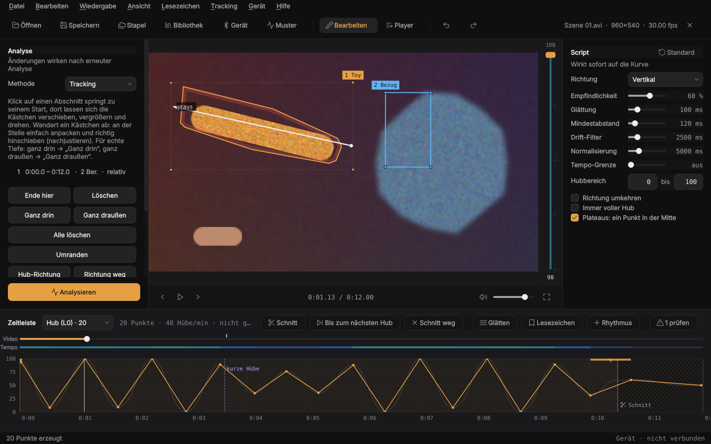

# Gestaltung

Die Oberfläche wurde mit der Methode von **unslop** gestaltet
(von Damir Sokolovsky, [@heydamir](https://x.com/heydamir),
[heydamir/unslop](https://github.com/heydamir/unslop), CC BY 4.0):
erst Audit, dann eine Richtung aus dem Produkt selbst, dann Abstände, Farbe,
Icons, Texte, Schrift, Layout, Details, Visuals und Bewegung in dieser Reihenfolge.

## Richtung

- **Produkt:** Ein lokales Werkzeug, das Bewegung im Video in ein bearbeitbares
  Hub-Script für ein Linear-Gerät übersetzt
- **Charakter:** exakt, mechanisch, ruhig
- **Welt:** ein Schnittplatz bei Nacht mit Oszilloskop, Timeline und Messinstrumenten
- **Moment:** die Hubkurve, das einzige Element mit Farbe
- **Signatur:** die Hubschiene rechts neben dem Video. Sie zeigt die
  Script-Position am Abspielkopf so an, wie sich später der Linearantrieb bewegt

## Regeln (`src/vtf/gui/theme.py`)

- Graphit-Grautöne für alle Flächen: `#0f0f10` Toolbar und Seitenleiste,
  `#141415` Fenster, `#19191b` Video und Kurve, `#232325` Eingabefelder
- Drei Textrollen: `#ededed`, `#a1a1a6`, `#85858b`
- Ein Akzent, Bernstein `#e5a043` (wie eine Tally-Lampe): Script-Kurve, primäre
  Aktion, Fortschritt, Abspielposition, Hubschiene, Bereich 1 beim Tracking. Sonst
  nirgends. Wählbar sind fünf weitere Vorgaben (alle hell genug für dunkle Schrift
  und weit genug vom Rot für Stopp und Fehler) oder eine eigene Farbe; ist sie zu
  dunkel, wird Text und Icon darauf weiß (`set_accent`)
- Texte: Deutsch ist der Schlüssel im Code (`tr("…")`), Englisch steht in
  `src/vtf/locale_en.py`; Werte als `{0}`, Mehrzahl über `plural()`, Dezimalzeichen
  über `dec()`
- Trennlinien sind Haarlinien mit 8 % der Textfarbe
- Linien-Icons von lucide, 16 px, Strichstärke 1,5, in der Farbe ihres Textes
- Zahlen, Zeiten und Werte in der Monospace-Schrift des Systems
- Abstände im 4-px-Raster, Radien 4 (Tasten), 8 (Eingaben, Buttons)
- Keine Animationen außer dem Abspielen selbst

