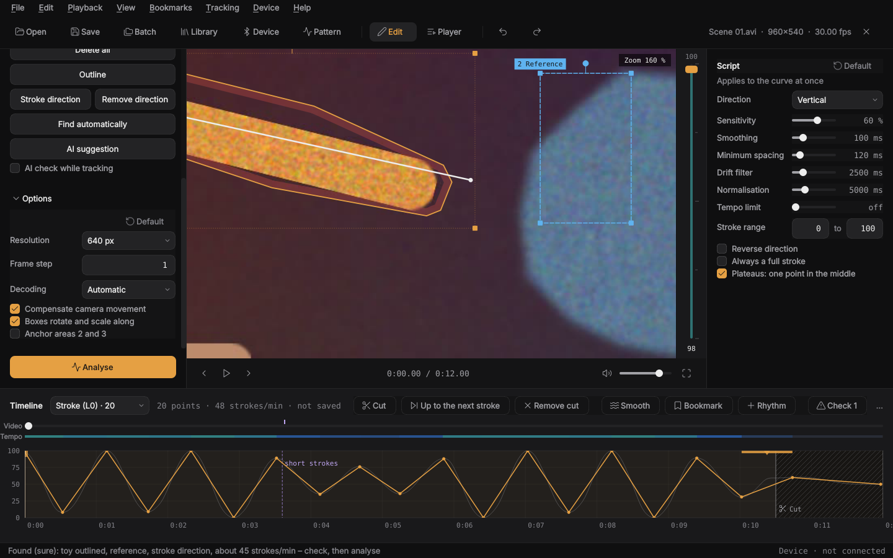
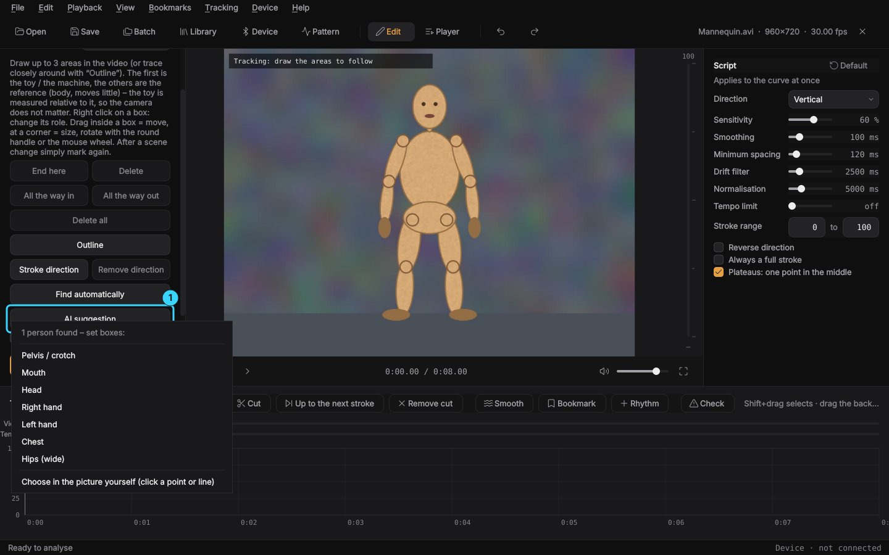
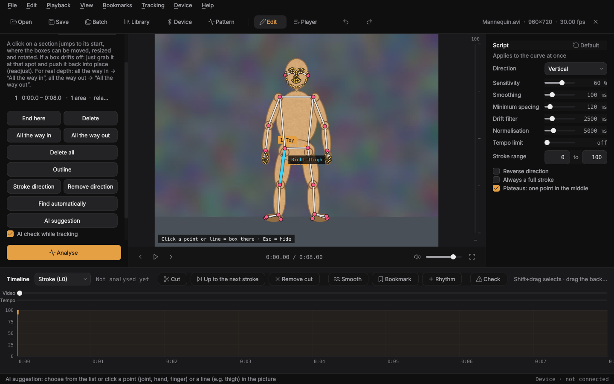
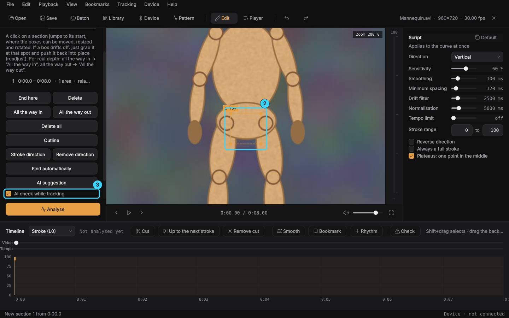
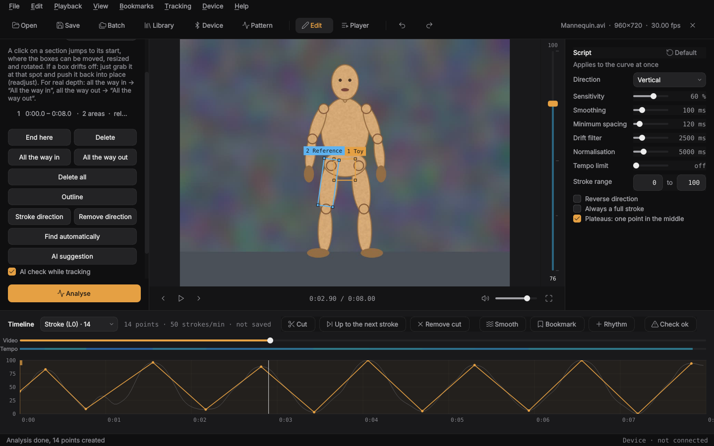

# Guide: from video to script

**English** · [Deutsch](anleitung.md)

Short and in order. Every feature is described in detail in the
[README](../README.md).

## The window

- **Left**: analysis. Method, tracking sections, options, the “Analyse”
  button. In the player the playlist is here.
- **Middle**: the video, next to it the stroke rail. It shows the script
  position, its colour shows the tempo.
- **Right**: script settings. They apply to the curve at once.
- **Bottom**: the timeline with video, tempo and the stroke curve for editing.

Ctrl+1 folds the left panel away, Ctrl+2 the right one.

## To the script in 8 steps

1. **Open a video**: Ctrl+O or drop the file onto the window. Opening a
   `.funscript` opens its video with it.
2. **Choose a method** (left):
   - *Image motion*: finds the strongest movement by itself. Fast, good with a
     calm camera and one clear movement.
   - *Tracking*: you mark what is followed. More precise, recommended.
3. **Mark** (with tracking): go to a spot where everything is easy to see and
   draw boxes in the video.
   - Faster: **Find automatically** (F) at a spot with even strokes. The app
     sets the toy (outlined), the reference and the stroke direction itself.
     Then check briefly that everything sits right, otherwise adjust as below.
   - **Box 1** on the part that moves (labelled “1 Toy” in the picture).
   - **Box 2** (and 3) on a counterpart that holds still or moves differently
     (labelled “Reference”, e.g. the body). The distance between 1 and the
     others is measured, so the camera hardly matters.
   - Marked the wrong way round? **Right click on the box** → “This is the toy”
     or “This is the body / reference”. The numbers swap.
   - **Outline** (button or key U): instead of a rectangle, hold the mouse
     button and trace closely around the toy. Only what lies inside is followed,
     a few pixels away from the edge (hatched red in the picture). Good when
     something right next to it moves differently, e.g. fingers, a hand or a
     foot. Right click → “Remove the outline” makes it a rectangle again.
   - **Delete**: right click on the box → “Remove area”, right click next to it
     → “Delete the section here”. Deleted by mistake? **Ctrl+Z** brings it back
     (roles, arrows and moved boxes too).
   - **Stroke direction** (button or key H): draw an arrow along the thrust, the
     tip points *out*. Then only the movement along the arrow is measured,
     sideways wobbling does not count. Good for machines that thrust at an
     angle. Applies at once, without a new analysis.
   - Pick spots with **texture or edges**, not smooth surfaces. Keep the
     background and anything that will be covered later out of the box.
   - Small spots: **Ctrl+mouse wheel** zooms into the video, hold the mouse
     wheel to move the view, Ctrl+0 resets.
   - Adjusting boxes: drag inside to move, a corner changes the size, the round
     handle or the mouse wheel rotates.
   - Or let the AI set the box, see [Boxes with the AI](#boxes-with-the-ai).
4. **Calibrate** (recommended): go to a spot where it is *all the way in* and
   press **All the way in** (D), then to *all the way out* and **All the way
   out** (A). Then the script uses the real depth.
5. **Scene change**: press **End here** (E) there and draw new boxes at the new
   spot. That starts a new section.
6. **Analyse**: the orange button at the bottom left.
7. **Check and correct**: play and watch whether the boxes keep up.
   - **Red** in the curve: an area was covered or lost here, no strokes are
     created there.
   - Something goes briefly **out of the picture**? No problem: the box waits at
     the edge, and the movement outside is continued.
   - A box sits wrong: **grab it at that spot and push it into place**, then
     analyse again. The time before is evened out too.
8. **Let it check**: markers at the top of the curve show spots worth a second
   look (too fast, gap, tremble, sudden small strokes, beat drops out, area
   lost). The **Check** button in the timeline = list, **F3** jumps to the next
   spot. If it says “Check ok”, you do not have to look through the whole script.
9. **Save**: Ctrl+S puts `<video>.funscript` next to the video. To collect all
   scripts in one folder instead (or as well): File → “Storage locations…” (there is also a folder for the video data, so
   nothing of the app lies next to your videos).

## Options (left, under “Options”)

| Option | When |
|---|---|
| Resolution | 640 px (default): more precise, good for small boxes. Smaller is faster |
| Compensate camera movement | leave on, important with only one box |
| Boxes rotate and scale along | on for bodies, **off for machines** and rigid parts |
| Anchor areas 2 and 3 | on when 2/3 sit on fixed parts and the camera is calm. Then nothing can pull them away. Off with camera moves |

## Fine-tuning the script (right)

| Setting | Effect |
|---|---|
| Direction | which movement in the picture becomes the stroke (a stroke arrow in the section wins) |
| Sensitivity | higher = small strokes too |
| Smoothing | irons out tremble |
| Plateaus: one point in the middle | on: a short rest all the way in/out becomes one point in the middle |
| Minimum spacing | shortest time between two points |
| Drift filter | removes slow wandering |
| Normalisation | stretches quiet stretches to a full stroke (irrelevant with calibration) |
| Tempo limit | shortens strokes that are too fast. F21S: about 500 /s |
| Stroke range | lowest and highest value, e.g. 10 to 90 |

Fixing by hand: drag points in the curve, a double click adds, a right click
deletes. **Ctrl+T** inserts a rhythm or a pattern from the pattern control for a range.

## Playing

- **Device**: start Intiface Central → “Start Server” → in the app
  **Device** (Ctrl+D) → Connect. The first time, best use Device →
  **Setup assistant**. Without a device: “Simulation”.
- **Player** (Ctrl+P): drag videos into the playlist, “Play playlist”.
  A quiet start is skipped, a countdown runs before the start
  (its length is set under “Countdown before the start”, 3–30 s).
  Cuts (see below) are skipped, and if you like every pause without strokes
  from 15 s (“Skip pauses without strokes”). When it goes on, the countdown runs
  as at the start.
- **Cut** (in the editor): where nothing happens, press **X** at the start and
  **X** at the end, or **Shift+X** = cut up to the countdown before the next
  stroke. Hatched in the curve; the player skips it. Remove: Edit → “Remove the
  cut here”. All of it is also on buttons at the top of the timeline (Cut, Up to
  the next stroke, Remove cut, Smooth, Bookmark, Rhythm).
- **Library** (Ctrl+L): every script in a folder with heatmap, search, sorting
  and stars. A double click plays, keys 1–5 rate.
- **Pattern** (Ctrl+M): play ready-made or your own patterns on the device
  without a video. Only two sliders, **Depth** and **Tempo**. They are
  remembered and can be changed while playing: ↑/↓ depth, ←/→ tempo, Space
  start/stop. A controller (Xbox/PlayStation) works too: left stick depth, right
  stick tempo, A start/stop, B stop, LB/RB change pattern. You build your own
  patterns from building blocks (New or “Change as a copy”), the picture shows
  right away what it looks like.
- **Programs** (switch at the top left): several patterns in a row, each with
  its own duration, tempo and depth, e.g. one hour from a slow start to the end.
  Per step, “Part” takes only a piece of a pattern.
- **Random** and **Music** (in the pattern control, top left): random changes
  pattern and tempo by itself, you set the depth with a slider as usual. With
  music the device follows the beat of the music playing on the PC.
- **Phone** (Device → Phone remote): open the address in the phone's browser and
  enter the PIN, or scan the QR code. In the “Video” tab you control the player:
  pause, seek, next video, time left.
- **Other players** (Device → Other players): mpv, VLC, DeoVR or HereSphere, the
  script lies next to the video.
- **Safety timer** (in the “Device” window, can be switched off): stop after X
  minutes, stop without input, pauses.
- **Esc** stops the device at once.

## When something does not fit

| Problem | Solution |
|---|---|
| A box slowly wanders off | mark a spot with more texture, grab it at that spot and push it back |
| A box gets skewed or long | switch off “Boxes rotate and scale along” |
| A hand or object pulls box 2/3 away | switch on “Anchor areas 2 and 3” |
| A box jumps to a finger, hand or foot next to the toy | **outline** the toy (U) instead of a rectangle |
| The curve is upside down | check the roles: right click on the toy → “This is the toy” |
| A machine thrusts at an angle, uneven strokes | draw the **stroke direction** (H) as an arrow along the thrust |
| Too many small trembling strokes | lower sensitivity, raise smoothing |
| Strokes too flat | calibrate (D/A) or use normalisation |
| The curve does not follow | wait 3 s after scrolling, it follows again |
| The analysis is slow | check the graphics card: Help → “Test decoding…” |
| Too much changed | “Default” next to the heading resets that section, a double click on a slider just that one |

## Keyboard shortcuts

| Key | Function |
|---|---|
| Space | play/pause |
| ← / → | frame back/forward, with Shift 1 s |
| E / D / A | section end, all the way in, all the way out |
| B, Alt+← / Alt+→ | set bookmark, previous/next |
| X, Shift+X | cut start/end, cut up to the next stroke |
| F3, Shift+F3 | next/previous spot from the check |
| F | find areas automatically (tracking) |
| U, H | outline, stroke direction (tracking) |
| Ctrl+mouse wheel, Ctrl+0 | zoom the video, reset the zoom |
| Ctrl+T | insert rhythm |
| Ctrl+S | save the script |
| Ctrl+W | close the video |
| Ctrl+P | player |
| Ctrl+M | pattern control |
| Ctrl+L | library |
| Ctrl+1 / Ctrl+2 | left/right panel on/off |
| F11 | full screen |
| Esc | emergency stop (stop the device) |

## Boxes with the AI

Instead of drawing boxes yourself, the AI can find the body parts. It runs on
your computer. The first time, the app asks whether it may download the models
(about 330 MB, once; an interrupted download resumes next time), after that no
internet is needed.

**1. Press AI suggestion** (or key K). First choose “Tracking” as the method
and go to a spot where the person is easy to see. A list of the body parts found
appears, with “Person 1”, “Person 2” if there are several. A click sets the box.

**Or choose in the picture yourself:** at the same time the AI draws the points
and lines it found into the video: joints, hands with fingers, feet and face.
When the mouse moves over them, the part lights up and shows its name. A click
on a **point** (e.g. knee, hand, finger) puts a box there. A click on a **line**
(e.g. a thigh) puts a turned box along the line, which gives the tracker more
area to follow. Esc or seeking hides the skeleton.

**2. Check the box** (2) and if needed move or resize it as usual. For a
counterpart (box 2) press AI suggestion once more, for example “Person 2: pelvis”.

**3. Tick AI check while tracking** (3) if the box would otherwise slip or is
often covered, for example by a hand. This works for boxes you drew yourself
too, as long as body points lie in them (hip joints, hand, mouth).

**4. Analyse.** With the AI check the analysis takes longer. The strokes are
still measured by the normal tracker, frame by frame. The AI only makes sure the
box stays on its body part. If it is covered for longer, the AI bridges the spot
with what it still sees of the body.

**When the AI finds nothing:** in very close shots where hardly anything of the
body can be seen. Then draw the boxes yourself as usual.
